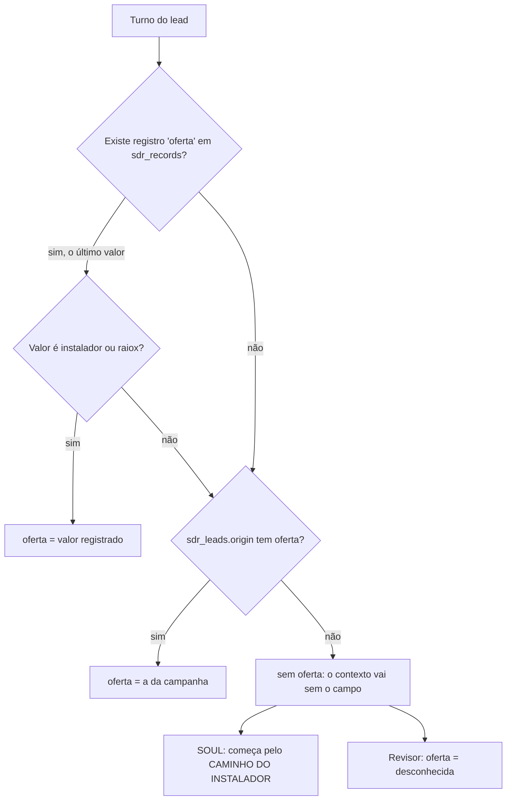
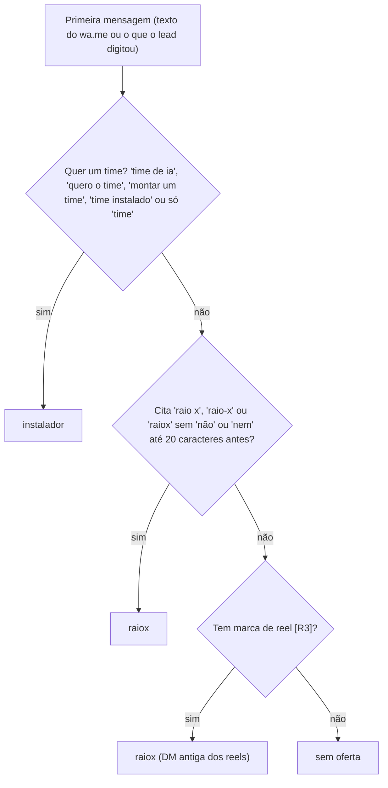
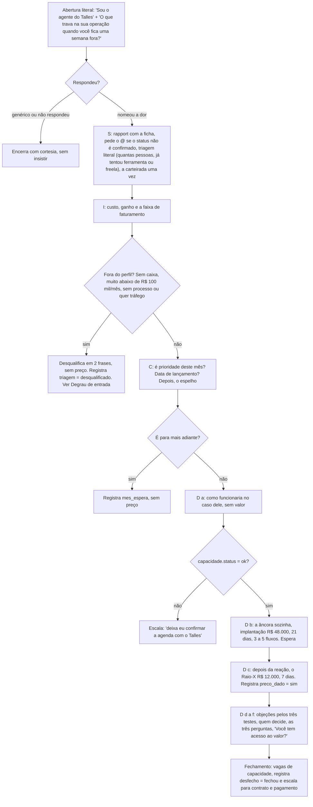
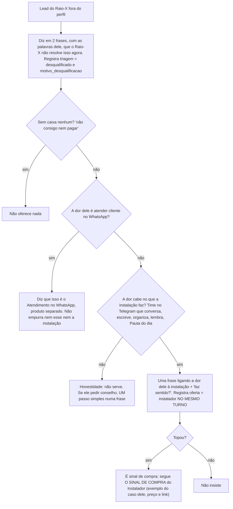
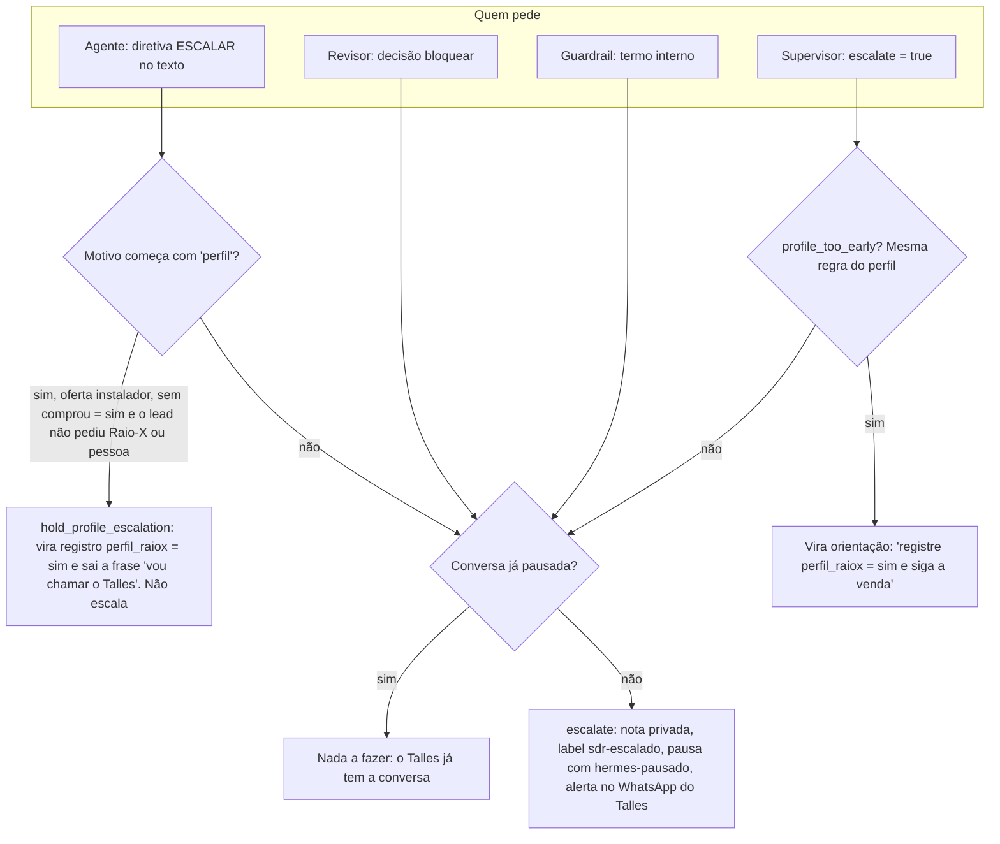
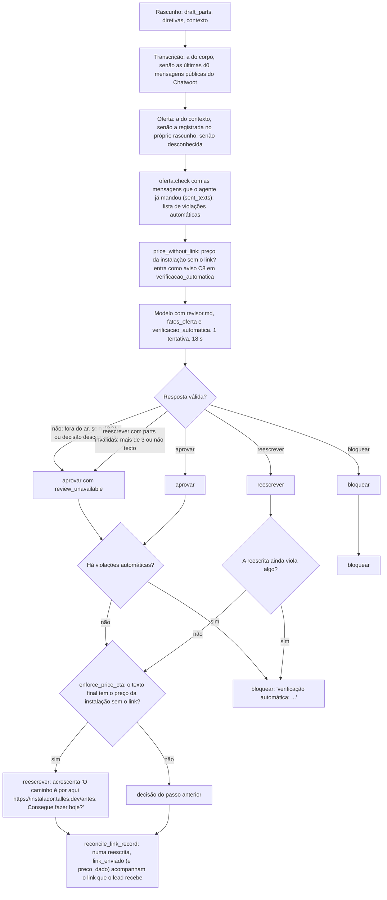
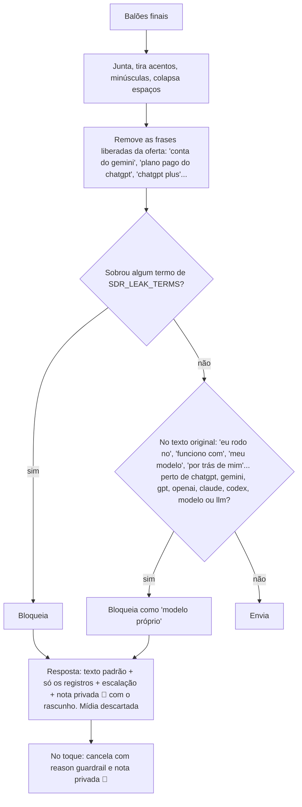
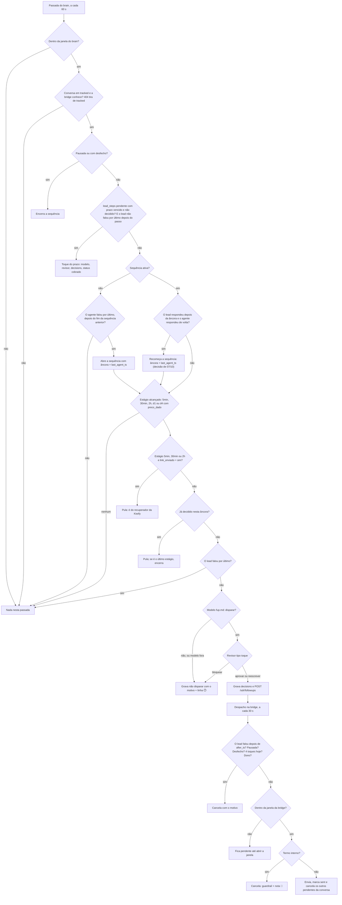
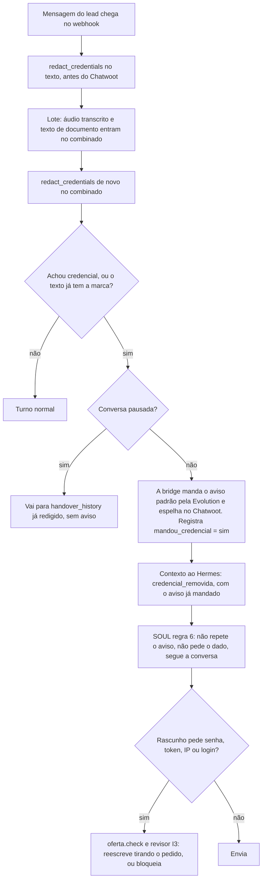

# Árvores de decisão do agente

> **Para que serve:** mostrar, em forma de árvore, cada decisão que o sistema toma sobre um lead: qual oferta, qual passo do roteiro, quando dar preço e link, quando escalar, o que o revisor aprova, o que o guardrail barra, quando sai um follow-up e o que fazer com uma credencial.
> **Data:** 08/10/2026, ~03:45 (BRT), depois da sessão TSX-77. Retrato de produção (SOUL md5 `62203261` em `hermes/volume-dados/SOUL.md`, idêntico a `hermes-sdr/SOUL.md`; bridge `sdr-v13.1`; brain `sdr-brain:v3.2`).
> **Fontes:** decisões de código citadas pela função; decisões do modelo citadas pela seção do SOUL ou do prompt (`sdr-brain/prompts/*.md`). Uma regra do SOUL é instrução ao modelo e não tem garantia de execução. Uma regra de código é determinística. Cada árvore diz qual é qual.

**O que mudou em 07–08/10 (TSX-77 e TSX-78).** No Instalador, quem chega com sinal de compra recebe o exemplo do caso dele, o preço e o link na mesma resposta (no máximo uma pergunta antes); a VPS e o Codex deixaram de ser perguntas de triagem e viraram valor dito junto do preço; o preço nunca sai sem o link, e o código acrescenta o link se faltar; antes do link não se oferece "outro momento"; o agente fala com o lead em 2ª pessoa; reação não é resposta; nome de IA solto é acusado já no brain; a referência de servidor é o KVM 8 da Hostinger, na faixa de R$ 120 a R$ 200 por mês. No follow-up, o relógio recomeça quando o lead responde e o agente responde de volta, e a resposta do Talles pelo Chatwoot conta como última mensagem do agente.

**Nome do produto de R$ 100.** O agente continua chamando o bump de R$ 100 de **"Conta do Gemini"**. No checkout da Kiwify ele aparece como **"1 Ano de Tokens"** (`nome_no_checkout` do bump "Conta do Gemini" em `ofertas.instalador.bumps`; antes era "Assinatura Gemini One"), e o agente pode dizer esse nome. "gemini" continua na lista de vazamento da bridge: "Gemini" sozinho é bloqueado, só as frases da oferta passam (seção 6). A troca planejada no commit `348cdb3` da cópia de trabalho (o agente dizer "1 Ano de Tokens" e tirar "gemini" do guardrail) **não** foi o que subiu; a cópia de trabalho foi alinhada à produção no commit `0de5284`.

---

## 1. Roteamento da oferta

### 1.1 Qual oferta vale neste turno (código)

`sdr.lead_offer` é chamada por `sdr.lead_state` a cada turno e lê os registros e a origem.

- **Precedência:** o registro do agente, `[[REGISTRO: oferta = …]]`, vence a campanha. Entre registros vale o último (`lead_state` monta um dicionário em ordem de criação).
- Na primeira mensagem, `record_offer_from_origin` já grava a oferta da campanha **como registro**. Por isso o agente só muda de oferta registrando outra.
- **No revisor** (`run_review`): se o contexto não traz oferta, mas o rascunho registra uma, o revisor usa a do rascunho.
- **No FUP** (`followup_once`): vale `oferta.current_offer(context)` e, se faltar, o registro.

### 1.2 Oferta a partir do texto da primeira mensagem (código)

A função é `sdr.offer_from_text`, chamada por `sdr.origin_from_text`. O texto é comparado sem acento e em minúsculas.

- O mesmo `origin_from_text` extrai `instagram` (o primeiro `@handle`, ignorando `@there` e `@username`), `peca` (`[R\d+]`) e `canal = instagram`.
- **"Querer o time" vence a palavra citada.** "não quero raio-x, quero o time" e "vi o raio x e quero montar um time" dão `instalador` (`test_sdr.test_what_the_person_wants_wins_over_the_word_she_cites`).
- **Situação de hoje** (MAPA, seção 5): a palavra "time" está na campanha `raiox`. Quem comenta TIME chega com "…quero saber mais sobre o Raio-X" e entra como `raiox`. A mudança para o Instalador depende de o agente registrar `oferta = instalador` quando a pessoa diz que quer o time.

### 1.3 Quando o modelo deve trocar a oferta (SOUL)

Seção "DUAS OFERTAS, UM FUNIL SÓ" do SOUL:

- Sem `oferta`, começa pelo Instalador. Nunca abre com o Raio-X nem pergunta "time ou Raio-X?". O revisor reescreve isso; veja "QUAL OFERTA" em `revisor.md`.
- Só é `raiox` quando a pessoa pede o Raio-X ou pede que o Talles olhe a operação inteira **sem falar em time**.
- Ao descobrir a oferta, o agente registra `[[REGISTRO: oferta = instalador|raiox]]`.
- **Degrau de entrada:** quando o Raio-X desqualifica a pessoa e o agente oferece a instalação, ele registra `oferta = instalador` **no mesmo turno** (seção 3).

---

## 2. Roteiro SPICED por oferta (SOUL)

As letras são as mesmas nas duas ofertas: S situação, P dor, I impacto, C evento crítico, D decisão. Cada uma tem o seu registro: `situacao`, `dor` (citação literal), `impacto`, `evento_critico`, `decisao`, e no Instalador `tem_vps` e `tem_codex` (registrados só se o lead contar; não se pergunta). O agente também registra `etapa_spiced` ao mudar de letra. Vale **um passo por turno e uma pergunta por vez**; no Instalador, exemplo + preço + link na mesma resposta contam como um passo só. O supervisor recebe as letras que faltam por `oferta.spiced_state`, que ainda lista `D:tem_vps`/`D:tem_codex` no Instalador; o `supervisor.md` proíbe transformar isso em pergunta de triagem.

### 2.1 Caminho do Instalador

R$ 47 é decisão pequena: o SOUL ("CAMINHO DO INSTALADOR", "O SINAL DE COMPRA") manda não qualificar quem já se qualificou e não dar saída antes do link. A descoberta SPICED fica para quem chega frio e para os degraus de cima depois da compra.

```mermaid
flowchart TD
    A["Primeira mensagem ou turno do lead"] --> SC{"Sinal de compra? 'quero', 'queria ter mais informações sobre o time', 'será que seria meu caso?', 'serve pra mim?', 'como compra?', 'quanto custa?', 'como funciona pra eu ter?', 'manda o link'. Chegar pelo 'TIME' também conta"}
    SC -->|sim| K{"Já sabe o que ele faz?"}
    K -->|sim| L["Mesma resposta, 3 mensagens: 1) o caso dele com UM exemplo concreto do nicho (o pedido e o que volta); 2) o preço com o custo mensal; 3) o link /antes + 'Consegue fazer hoje?'. Registra link_enviado, preco_dado, etapa_spiced = fechamento, proximo_passo = comprar pelo link e data"]
    K -->|"não"| U["Responde o que ele perguntou (se foi o preço: preço e link) + a ÚNICA pergunta: 'O que você faz? Te digo como fica no seu caso.'"]
    U --> L2["Resposta seguinte: o exemplo do nicho e, se ainda não saíram, o preço e o link"]
    SC -->|"não: chegou frio, curiosidade ('vi o reel, o que é isso?', 'como funciona?', 'como seria isso pra mim?')"| F1["Uma frase do que é + S: o que ele faz"]
    F1 --> F2["Um exemplo do nicho dele + P: o que mais toma o tempo dele"]
    F2 --> O["Oferta pela equação de valor, uma resposta: o resultado como UM exemplo concreto, só no que a instalação faz; o esforço que sai das costas dele (5 campos) e a garantia 'Pronto em 48 h'. Termina puxando para o link: 'Quer que eu te mande o caminho?'"]
    O --> Q{"Dor = atender cliente no WhatsApp?"}
    Q -->|sim| Q1["Antes de qualquer preço: isso é o Atendimento no WhatsApp, R$ 3.000, separado"]
    Q -->|"não"| I2{"Mostrou interesse? 'sim', 'quero', 'quanto é?'"}
    Q1 --> I2
    I2 -->|"sim: é sinal de compra"| L
    L --> D1{"Depois do link: o que ele disse?"}
    L2 --> D1
    D1 -->|"dúvida ou objeção"| OBJ["Fechamento a/b: responde o que falta e volta ao link. Classifica: pré-requisito, pergunta ou objeção. Um ramo por turno"]
    OBJ --> D1
    D1 -->|"não tem servidor ou Codex"| E["Fechamento d: o servidor como valor, /antes mostra o que contratar, sem Codex a Conta do Gemini na compra; pergunta QUANDO. Registra tem_vps = não, proximo_passo = contratar a VPS e comprar pelo link, data"]
    D1 -->|"vai comprar ou pergunta o que vem depois"| PD["Fechamento c: área do cliente com o mesmo e-mail, 5 campos, 'Pronto.' no Telegram em até 48 h"]
    PD --> C{"Disse que comprou?"}
    C -->|sim| PC["Registra comprou = sim. Próximos passos até o 'Pronto.'. Se perfil_raiox = sim, escala"]
```

**Quando dar o preço**

- **Com sinal de compra:** já na resposta ao sinal, se o agente sabe o que o lead faz; senão, na resposta seguinte à única pergunta. Se o lead pediu o preço sem dizer o que faz, o preço e o link saem na hora, com a pergunta sobre o negócio (SOUL, "O PREÇO"; I6).
- **Lead frio:** depois de S e P e da oferta pela equação de valor, assim que ele mostrar interesse.
- **Exemplo antes ou junto** (I6): na primeira vez que o preço ou o link aparecem, já precisa ter saído UM exemplo concreto do caso do lead. Se falta e o transcript diz o que ele faz, o revisor acrescenta uma frase de exemplo, sem tirar o preço nem o link.
- Preço uma vez por turno, sempre com o custo mensal (I8). As três formas estão em `ofertas.instalador.custo_mensal` e no SOUL:
  - **com Codex:** "A instalação é R$ 47, pagamento único. Por fora ficam o seu servidor, na faixa de R$ 120 a R$ 200 por mês, e o Codex, cerca de R$ 100 por mês, pagos direto a eles, no seu nome."
  - **com a Conta do Gemini:** a Conta do Gemini custa R$ 100 uma vez, na mesma compra, e por mês fica só o servidor (R$ 120 a R$ 200). Para quem vai levar a Conta do Gemini, o agente não cita o Codex.
  - **já tem o Codex:** por mês fica só o servidor. O Codex é o plano pago do ChatGPT que ele já paga.
- **O preço nunca sai sozinho** (SOUL, "O PREÇO"; C8): na mesma resposta vão o link `https://instalador.talles.dev/antes` e uma pergunta de próximo passo ("O caminho é por aqui https://instalador.talles.dev/antes. Consegue fazer hoje?"). Acabou a regra antiga de "o turno do preço termina no preço, sem pergunta".
- **No código** (`enforce_price_cta`, TSX-78): se o rascunho (ou a reescrita) tem o preço da instalação ("R$ 47, pagamento único", "a instalação é/custa/sai R$ 47") sem o link, o brain acrescenta "O caminho é por aqui https://instalador.talles.dev/antes. Consegue fazer hoje?", seja qual for a decisão do modelo, e mesmo com o modelo fora. Com 1 ou 2 balões, vira um balão novo; com 3 balões ou num toque, vai no fim do último, e uma pergunta final que não é de próximo passo sai para dar lugar à do link. Não vale depois de `comprou = sim` nem no Raio-X (salvo o degrau de entrada).

**Quando mandar o link `https://instalador.talles.dev/antes`**

- Sempre junto com o preço (acima). Não há mais checklist S, P e D antes do link.
- Com sinal de compra, no máximo UMA pergunta antes do link, e só se o agente ainda não sabe o que o lead faz (I1).
- Lead frio: depois de dizer o que faz e o que toma o tempo dele. Mandar o link sem descoberta não é erro no Instalador (I1).
- O que vem depois da compra (área do cliente, 5 campos, "Pronto." em até 48 h) agora vem depois do link, quando o lead vai comprar ou pergunta (fechamento c).
- **No código**, `oferta.check` só aceita links do host `instalador.talles.dev`. Qualquer outro link é violação automática.
- **`link_enviado` segue o que o lead recebe** (`reconcile_link_record`): numa reescrita, se o link entrou (inclusive o que o código acrescentou), o registro `link_enviado = sim` é acrescentado; se a reescrita tirou o link, `link_enviado` sai, e `preco_dado` também sai se não sobrou preço. O conjunto corrigido de diretivas vai no último balão, que a bridge passa a usar.

**Pré-requisitos** (`ofertas.instalador.pre_requisitos`; SOUL, "O QUE É")

- **Servidor (VPS): é valor, não triagem.** O agente não pergunta "você tem VPS?" antes de o lead querer (I2). Quando fala dele (no preço, ou se o lead pergunta ou diz que não tem), usa estas ideias: fica fora do computador do lead, então o time trabalha mesmo com o computador desligado; o lead contrata onde quiser, no nome dele (o Talles indica a Hostinger); fica na faixa de R$ 120 a R$ 200 por mês; dá para ter vários agentes nele; a instalação deixa a estrutura pronta. Plano, só como exemplo: "o KVM 8 da Hostinger". Obrigatório para todos. A página `/antes` mostra o que contratar.
  - A regra I7 do revisor proíbe outro plano (KVM2, KVM 2), "4 GB" e "módulo".
  - **No código**, R$ 119 (a referência antiga da KVM2) deixou de existir em `ofertas.json` e passou a ser barrado como "valor que não existe na oferta"; R$ 120 e R$ 200 passaram a ser permitidos.
- **IA, uma das duas:**
  - **Codex:** plano pago do ChatGPT, Plus ou maior, cerca de R$ 100 por mês. Conta grátis não funciona. Entra como valor junto do preço, não como pergunta.
  - **Conta do Gemini:** bump de R$ 100, pago uma vez, na compra; no checkout se chama "1 Ano de Tokens". Substitui o Codex **só** nesse caso. O agente não promete por quanto tempo ela dura: `oferta.check` barra frases como "a Conta do Gemini é vitalícia, por 1 ano…", mas aceita o nome "1 Ano de Tokens". Quem já comprou sem ela recebe o link avulso pelo Talles (escalação).
- "Não tenho VPS" e "não tenho Codex" são **pré-requisito, não objeção** (fechamento d; I2). O agente explica o servidor como valor, aponta `/antes` e pergunta **quando**.
- **No brain** (`record_step`), `tem_vps = não` ou `tem_codex = não` sem data cria sozinho o passo "conferir se já contratou…" para o dia seguinte, e isso gera um toque de prazo.

**O que nunca aparece antes da compra registrada** (`comprou = sim`): Raio-X, Copiar a minha operação, os preços deles e os números de cases.

- O código barra no Instalador sem compra: `oferta.check` (`UPPER_STEP_RE`), e os preços de `degraus_acima` ficam de fora dos valores permitidos (`offer_amounts(..., upper_steps=False)`).

### 2.2 Caminho do Raio-X

**Quando dar o preço** (regras R1 a R4 do SOUL, X1, X2, X5 e X6 do revisor)

- Só depois de P (dor concreta), I (custo dito por ele e faturamento dentro do perfil) e C (quer resolver agora).
- Se ele pede antes, o agente adia uma vez ("te passo o número já já. Antes, …"). Se ele pede de novo, vai ao preço.
- Preço e vagas só com `capacidade.status = "ok"`. Vagas = `capacidade.vagas_restantes`; o total do mês = `vagas_total`.
- `sdr.capacity` devolve `desatualizado` se o arquivo tem mais de 7 dias, e `desconhecido` se ele falta ou está quebrado. Também calcula `pode_oferecer_este_mes`: falso quando não há vaga ou quando `horas_comprometidas` passa de `horas_limite`.
- R$ 48.000 (a implantação) sempre **antes** de R$ 12.000, em respostas separadas. A âncora é a implantação, nunca o "Copiar a minha operação". `oferta.check` (`COPIAR_SWAP_RE`) acusa quem troca um pelo outro.

### 2.3 Fora do roteiro, nas duas ofertas

- **Primeira mensagem:** sempre "Sou o agente do Talles" (regra 1 do SOUL).
- **Despedida já feita** e o lead manda só obrigado ou emoji: a resposta é `[[SILENCIO]]`. Nada é enviado e o revisor é pulado, porque não há balões.
- **Próximo passo:** depois de toda troca que muda algo, registrar `proximo_passo` e `proximo_passo_em` (AAAA-MM-DD ou AAAA-MM-DDTHH:MM). O agente nunca promete contato. `oferta.check` (`CONTACT_PROMISE_RE`) barra "te chamo", "volto a te chamar", "passo aqui".
- **Todo turno termina em UMA pergunta**, menos escalação e despedida. No Instalador, a pergunta puxa para o próximo passo ("Consegue fazer hoje?").
- **Sem saída antes do link** (Instalador ou oferta desconhecida): enquanto o link `/antes` não saiu, nada de "outro momento", "outra hora", "quando puder", "quando quiser", "prefere olhar depois?", "mais pra frente" (SOUL, "COMO VOCÊ ESCREVE"; revisor C15). Depois do link, a saída honesta pode. **No código**, `oferta.check` acusa a saída (`OTHER_TIME_RE`) quando a oferta não é `raiox`, não há `comprou = sim`, o rascunho não traz o link e o link não saiu antes (registro `link_enviado = sim` ou uma mensagem do agente com o link no transcript). Data do próprio passo do lead ("ficou pra outro dia?") não conta.
- **Fala com o lead, em 2ª pessoa** ("você", "seu", "sua"), nunca "a empresa dela", "o negócio dele", "o lead", "o cliente" (SOUL; revisor C14 e "A REESCRITA FALA COM O LEAD"). Falar de uma terceira pessoa que o lead citou (o sócio dele) pode. **No código**, `oferta.check` acusa `THIRD_PERSON_RE` ("empresa/negócio/caso/servidor/nome/conta/clientes… dela/dele", "do/da/pro/pra lead") em qualquer oferta, salvo se a mesma expressão veio do lead.
- **Reação não é resposta.** "[Reação recebida: ❤️ …]" ou um emoji solto não é "sim": não se avança por causa dela (nada de preço novo, nada de registrar decisão). O agente retoma a pergunta pendente, curta, com o exemplo concreto do caso dele; no Instalador, se o lead já mostrou interesse e o link não saiu, o link vai junto (SOUL; revisor C16; `supervisor.md`; `fup.md`). Regra só do modelo, sem checagem no código.
- **Nome de IA nunca solto.** "o plano pago do ChatGPT", "o ChatGPT Plus", "o Codex" e "a Conta do Gemini" podem; "o ChatGPT" ou "Gemini" sozinhos não, mesmo quando o lead disse "assino o ChatGPT" (SOUL, sigilo; revisor C1). **No código**, `oferta.check` acusa `BARE_AI_NAME_RE` (chatgpt, gemini, openai, claude, anthropic, gpt-) fora das frases da oferta (`AI_OFFER_PHRASES`, a mesma lista de `SDR_OFFER_PHRASES` da bridge). Assim o revisor reescreve antes, em vez de a bridge bloquear e escalar no guardrail (seção 6).

---

## 3. Degrau de entrada: o desqualificado do Raio-X

Decisão do Talles de 06/10. Está no SOUL, em "S, SITUAÇÃO E PERFIL", na regra X4 do revisor e em `oferta.check`.

**No código** (`oferta.check`), com `oferta = raiox` e `triagem = desqualificado` (`oferta.disqualified`), os valores do Instalador sem os degraus de cima também passam a ser permitidos. Assim, o preço da instalação dito no turno do degrau não é barrado como "valor que não existe".

O revisor só reprova (X4) quando o rascunho:
- empurra a instalação para uma dor que ela não resolve;
- insiste depois de um não;
- oferece algo a quem está sem caixa nenhum.

---

## 4. Quando escalar ao Talles

### 4.1 Quem pode pedir a escalação

- `hold_profile_escalation` (bridge) e `profile_too_early` (brain) usam o mesmo teste para saber se o lead pediu:
  - "raio x", "copiar a minha opera…", "humano", "falar com o Talles, uma pessoa, alguém ou vocês", "atendente".
- Se o rascunho só dizia que ia chamar o Talles e não sobra nada depois de tirar essa frase, a escalação **é mantida** ("nothing else to say").

### 4.2 Os motivos de escalar no SOUL e no supervisor

| Motivo | Instalador | Raio-X | Fonte |
|---|---|---|---|
| Pediu uma pessoa, o Raio-X ou o Copiar | escala na hora, antes ou depois da compra, sem preço | escala | SOUL, "A ESCADA" e "QUANDO CHAMAR O TALLES"; `supervisor.md` |
| Irritado | escala | escala | SOUL; `supervisor.md` |
| Reembolso ou reclamação de compra | escala | escala | SOUL; `supervisor.md` |
| Dúvida técnica fora do roteiro (outro servidor, outro sistema, integração) | escala | escopo fora que precisa de resposta agora | SOUL; `supervisor.md` |
| Travou para contratar a VPS ou o Codex | escala (`[[ESCALAR: travou para contratar VPS ou Codex \| …]]`) | — | SOUL, "O QUE É" |
| Quer o link avulso da Conta do Gemini depois da compra | escala | — | SOUL, "O QUE É" |
| Perfil para os degraus de cima | **só depois** de `comprou = sim`; antes, só o registro `perfil_raiox` | — | SOUL, "A ESCADA"; código acima |
| "Vou pensar" | **não** escala: pergunta o que ele quer pensar e combina uma data | escala ("preciso pensar", "vou ver" sem data, indecisão, "não" persistente na pergunta de confiança, muda de assunto) | SOUL; `supervisor.md` |
| Capacidade incerta na hora do preço | — | escala ("deixa eu confirmar a agenda…"); o revisor aprova essa escalação e nunca a troca por âncora, preço ou vagas | SOUL R1; revisor X2 e X2b |
| Fechamento | — | escala com `desfecho = fechou` para contrato e pagamento | SOUL, "D, DECISÃO" |
| Objeção sobre ele (insegurança, já foi queimado com critério escrito) | — | escala (teste 3) | SOUL, "OBJEÇÕES DO RAIO-X" |
| Sigilo ou nome de cliente no rascunho | revisor bloqueia, e isso escala | idem | `revisor.md` C1 e C2 |
| Violação dura que a reescrita não corrigiu | bloqueio automático, e isso escala | idem | `enforce_offer_rules` |
| Termo interno no texto final | guardrail, e isso escala | idem | `deliver_agent_reply` |

Depois de escalar, o SOUL manda **parar**. A bridge garante a parada, porque pausa a conversa.

---

## 5. O revisor (`POST /review`)

### 5.1 Fluxo da decisão (código, `sdr-brain/app.py`)

O aviso de preço sem link nunca vira `bloquear`: ele não entra na lista que bloqueia, e o código conserta sozinho. As outras violações automáticas continuam bloqueando se sobreviverem à reescrita.

**O que a bridge faz com cada decisão** (`review_reply`)

- `aprovar`: segue.
- `reescrever`: troca os balões.
- `bloquear`: resposta padrão + escalação.
- Erro ou timeout (22 s): segue com o rascunho.

O brain escreve no Chatwoot a linha ✏️ ou ⛔ quando a decisão não é `aprovar` e o motivo não é `review_unavailable`.

### 5.2 Regras que o modelo aplica (`prompts/revisor.md`)

**Princípios**

- **Na dúvida, aprova.**
- **Bloquear** só para C1 (sigilo) e C2 (nome de cliente). Todo o resto se conserta reescrevendo.
- **A reescrita só corta ou conserta**, nunca acrescenta preço, link, âncora ou passo. Exceções, só no Instalador: I8 (o custo mensal junto do preço), C8 (o link e o próximo passo junto do preço) e I1 (sinal de compra: exemplo, preço e link).
- **A reescrita fala com o lead**, como o rascunho: "você", "seu", "sua", nunca em 3ª pessoa.
- Diretivas `[[…]]` devem ficar idênticas.
- **Toque** (`tipo = toque`): não aplica C5 e devolve uma parte só.

**Regras comuns**

| Regra | Conteúdo | Ação |
|---|---|---|
| C1 | Sigilo: modelo, IA, empresa, plataforma, prompt, contexto. Falar do Codex, do plano pago do ChatGPT e da Conta do Gemini **do cliente** não é sigilo, mas nunca com o nome solto ("o ChatGPT", "Gemini"): isso se reescreve como "o plano pago do ChatGPT", "o ChatGPT Plus" ou "a Conta do Gemini". | bloquear (nome solto: reescrever) |
| C2 | Nome de cliente ou de operação anterior | bloquear |
| C3 | Curso, aula, mentoria, "eu te ensino" | reescrever |
| C4 | Concorrente e a lista `{{PROIBIDOS}}`, que vem de `oferta.forbidden_list()` | reescrever |
| C5 | Pergunta direta do lead respondida primeiro | reescrever |
| C6 | No máximo 3 mensagens curtas | reescrever |
| C7 | Um passo por turno. No Instalador, o exemplo do caso, o preço com o custo mensal, o link e a pergunta do próximo passo contam como um | reescrever |
| C8 | Termina em pergunta, salvo escalação e despedida. No Instalador, o turno do preço sai COM o link e a pergunta do próximo passo; faltando, a reescrita acrescenta (e o código também, `enforce_price_cta`). Antes do link, a pergunta final não oferece saída | reescrever |
| C9 | Voz "eu / o Talles", nunca "nós" ou "a gente" | reescrever |
| C10 | Nada fora dos fatos: logística inventada, resultado em dinheiro, promessa de contato | reescrever |
| C11 | Nada de dossiê que não está no contexto (a ficha pode) | reescrever |
| C12 | Objeção no ramo certo, começando por reconhecer | reescrever |
| C13 | Escassez só com dado real: 15 por dia, ou `vagas_restantes` | reescrever |
| C14 | Fala com o lead: nada de 3ª pessoa sobre quem lê ("direto pra empresa dela", "o lead") | reescrever |
| C15 | Sem saída antes do link (Instalador ou oferta desconhecida): "outro momento", "quando puder", "prefere olhar depois?"… | reescrever |
| C16 | Reação ou emoji solto não é "sim": retomar a pergunta pendente com o exemplo do caso | reescrever |

**Instalador**

| Regra | Conteúdo |
|---|---|
| I1 | Sinal de compra pula a descoberta: depois dele, e enquanto o link não saiu, nada de voltar a perguntar (quantas pessoas, o que toma o tempo, VPS, Codex) nem adiar o link; a reescrita traz exemplo concreto do nicho, preço com custo mensal e link. Única pergunta permitida antes: o que o lead faz. Curiosidade de quem chegou frio não é sinal de compra |
| I2 | VPS ou Codex é pré-requisito, não objeção: explica o servidor como valor (KVM 8 como exemplo, R$ 120 a R$ 200 por mês), aponta `/antes` e pergunta quando. Perguntar "você tem VPS?" como triagem → reescrever |
| I3 | Nunca pede senha, token, IP ou usuário |
| I4 | Sem promessa de faturamento, sem desconto, prazo de até 48 h, garantia como nos fatos |
| I5 | Raio-X, Copiar e cases só depois de `comprou = sim` |
| I6 | Exemplo concreto do caso antes ou junto do primeiro preço ou link; nunca trocar o preço ou o link por mais descoberta |
| I7 | Sem vídeo, sem tela, servidor só "por exemplo o KVM 8 da Hostinger" (nunca KVM2, "4 GB" ou "módulo"), sem duração da Conta do Gemini (o nome "1 Ano de Tokens" pode) |
| I8 | Preço com o custo mensal |
| I9 | A instalação não é atendimento no WhatsApp |

**Raio-X**

| Regra | Conteúdo |
|---|---|
| X1 | R$ 12.000 só depois de R$ 48.000 |
| X2 | Preço e vagas só com capacidade `ok` |
| X2b | A escalação por capacidade incerta na hora do preço está certa: aprovar, nunca trocar por âncora, preço ou vagas, e nunca aplicar X1 a ela |
| X3 | Só os números autorizados ("mais de" só nos 300 mil) |
| X4 | Fora do perfil, sem preço do Raio-X (com a exceção do degrau de entrada) |
| X5 | Carteirada, dossiê, âncora e Raio-X nunca juntos |
| X6 | SPICED (P, I, C) antes de qualquer valor; exceção: pediu o preço duas vezes |
| X7 | Os dois produtos de R$ 48.000 não se trocam |

As frases literais do roteiro do Raio-X **nunca** são reescritas.

### 5.3 Checagens automáticas (`oferta.check`, determinísticas)

Toda violação encontrada vira um item de `verificacao_automatica`. Se ela sobreviver à decisão do modelo, a resposta vira `bloquear`. A exceção é o preço da instalação sem o link (última linha): ele aparece na lista para o modelo, mas é consertado pelo código e nunca bloqueia.

| Checagem | Vale quando | Como detecta |
|---|---|---|
| Nome ou frase proibida (Naia, Squad, Avalanche, Denderson; "Bom dia, Naia", "Pare de contratar"…; Rafael, Juliana, Davi, Paulo, Jonathan) | sempre | `forbidden_hits`. Um nome que o próprio lead usou não conta. |
| Fala do lead em 3ª pessoa | sempre | `THIRD_PERSON_RE` ("empresa/negócio/caso/servidor/vps/nome/conta/agenda/clientes/alunos/trabalho/método/telegram dela/dele", "do/da/pro/pra/para o/para a lead"), salvo se a mesma expressão veio do lead |
| Saída antes do link ("outro momento", "quando puder", "olhar depois", "mais pra frente") | oferta ≠ raiox, sem `comprou = sim`, sem o link no rascunho e sem o link já enviado (registro `link_enviado = sim` ou mensagem do agente no transcript) | `OTHER_TIME_RE`, salvo frase negada |
| Nome de IA solto | sempre | `BARE_AI_NAME_RE` (chatgpt, gemini, openai, claude, anthropic, gpt-) depois de tirar as frases da oferta (`AI_OFFER_PHRASES`: "conta do gemini", "plano pago do chatgpt", "chatgpt plus"…, a mesma lista de `SDR_OFFER_PHRASES` da bridge) |
| Valor que não existe na oferta | sempre que há valores permitidos | `_price_issues`. Os valores vêm de `ofertas.json`: **instalador** sem os degraus de cima antes da compra; **raiox** com tudo do Raio-X, mais o Instalador sem degraus se desqualificado; **sem oferta**, os dois. Um valor dito pelo lead passa só quando aparece como custo **dele** ("você paga R$ 2.000") e não como preço nosso. Desde 08/10, R$ 120 e R$ 200 (servidor) entram e R$ 119 sai. |
| Preço errado para o produto ("o Raio-X é R$ 9.000") | sempre | `_product_price_issues` com `product_prices` |
| Link fora da oferta | sempre | todo host diferente de `instalador.talles.dev` |
| Pede senha, token, IP, login ou dado do servidor | sempre | `_asks_for_secret`. Dizer que o dado vai "no formulário" não conta, nem a pergunta do lead "é seguro passar a senha?". |
| Promessa de faturamento | sempre | `REVENUE_PROMISE_RE`, salvo frase negada |
| Desconto ou cupom | sempre | `DISCOUNT_RE` |
| Promessa de contato numa data | sempre | `CONTACT_PROMISE_RE` |
| Duração da Conta do Gemini | sempre | `GEMINI_DURATION_RE`. "1 ano de tokens" (o nome no checkout) não conta como prazo. |
| Implantação trocada pelo Copiar | sempre | `COPIAR_SWAP_RE` |
| Prazo abaixo de 48 h ("em 24 h", "amanhã pronto") | oferta ≠ raiox | `FAST_DEADLINE_RE`, com os links retirados antes (o host "instalador.talles.dev" perto de "amanhã" não é "instalado amanhã") |
| Diz que existe vídeo | oferta ≠ raiox | `VIDEO_RE` |
| Número de case do Raio-X | oferta ≠ raiox | `RAIOX_PROOF_RE` |
| Instalação vendida como atendimento no WhatsApp | oferta ≠ raiox | `WHATSAPP_SERVICE_RE`, salvo se a frase cita "Atendimento no WhatsApp" ou R$ 3.000 |
| Raio-X ou Copiar antes da compra | oferta = instalador e sem `comprou = sim` | `UPPER_STEP_RE` |
| Preço da instalação sem o link `/antes` (C8) | sem `comprou = sim` e oferta ≠ raiox (ou raiox com `triagem = desqualificado`) | `price_without_link` (`INSTALL_PRICE_RE`: "R$ 47, pagamento único", "a instalação/o time é, custa, sai, fica R$ 47"). **Não bloqueia**: `enforce_price_cta` acrescenta o link e "Consegue fazer hoje?" |

A regex `_negated` ignora uma violação quando há "não", "nunca", "nem", "jamais" ou "sem" antes dela na mesma oração.

---

## 6. Guardrail da bridge (termos de vazamento)

É a última barreira antes do envio, e é determinística. Roda em toda resposta, depois do revisor (`deliver_agent_reply`), e em todo toque (`process_followups_once`).

**Termos em produção** (padrão de `SDR_LEAK_TERMS` em `sdr.py`): `hermes`, `nous research`, `nousresearch`, `omniroute`, `antigravity`, `gemini`, `openai`, `chatgpt`, `gpt-`, `claude`, `anthropic`, `chatwoot`, `evolution api`, `evolution go`, `evogo`, `openreply`, `portainer`, `traefik`, `docker`, `system prompt`, `soul.md`, `/opt/`, `evento_estruturado`, `x-hermes`, `api_server`, `skill_view`, `skills_list`, `skill_manage`.

- Termos que começam e terminam em letra ou número exigem fronteira de palavra. Os outros, como `/opt/` e `gpt-`, casam como substring.
- **Frases liberadas** (`SDR_OFFER_PHRASES`): "conta do gemini", "oauth do gemini", "assinatura do gemini", "assinatura gemini one", "gemini one", "seu gemini", "sua conta do gemini", "gemini advanced", "plano pago do chatgpt", "plano do chatgpt", "assinatura do chatgpt", "conta do chatgpt", "conta gratis do chatgpt", "conta gratuita do chatgpt", "seu chatgpt", "chatgpt plus", "chatgpt pro".
- "Gemini" dito sozinho ("os tokens são do Gemini") **é bloqueado**, e "ChatGPT" sozinho também. Desde 08/10 o brain acusa o nome solto antes (`oferta.check`, `BARE_AI_NAME_RE`), para o revisor reescrever como frase da oferta; o guardrail continua como última barreira. A ideia de tirar `gemini` da lista (commit `348cdb3` da cópia de trabalho) não subiu e foi desfeita no alinhamento com a produção (`0de5284`).
- Antes do guardrail, `sdr.parse_reply` já tirou todo `[[…]]`, e `extract_hermes_media` tirou os `MEDIA:`. Mensagens que o Talles escreve no Chatwoot **não** passam pelo guardrail nem pelo `plain_style`.

---

## 7. Follow-up: disparar ou não

Juntam-se aqui as três camadas: o laço do brain, o modelo (`fup.md`) e o despacho da bridge.

**O relógio recomeça** (`followup_once`, decisão do Talles de 07/10). Antes, a âncora não mudava quando o lead respondia no meio, e um estágio vencido durante a conversa era pulado como "conversa em andamento" (menos de 30 min de silêncio, `SDR_QUIET_AFTER_REPLY_SECONDS`). Agora, se o lead respondeu durante a sequência e o agente respondeu de volta, a sequência recomeça na última mensagem do agente e 5min, 30min e 2h valem de novo (log "FUP sequence restarted"). O teste dos 30 min continua no código, mas, com o recomeço, não tem mais caso em que dispare. Depois do link, 5min, 30min e 2h continuam com a Kiwify, então o recomeço só pesa no `d1` e no `d4`.

**Resposta do Talles pelo Chatwoot** conta como última mensagem do agente (`chatwoot_webhook` chama `sdr.touch_activity(agent=True)`, bridge `sdr-v13.1`). A intenção é que, quando ele tira a pausa, o follow-up recomece a partir da resposta dele. Ressalva lida no código, não reproduzida: se havia sequência ativa quando a conversa foi pausada, o brain a encerra (`pausada`) na passada seguinte, depois da resposta do Talles; como uma sequência nova só abre com `last_agent_ts` posterior ao fim da anterior, uma resposta única do Talles pode não abrir sequência nova. Resposta pelo celular (`fromMe`) não passa por aí e não mexe em `last_agent_ts`.

**Quando o modelo não deve disparar** (`fup.md`, "NÃO DISPARE"):

- o lead disse que responde depois, marcou um dia ou horário que ainda não chegou, pediu para não ser contatado ou já disse não;
- a última mensagem do agente foi despedida, encerramento ou escalação;
- o assunto se resolveu: decisão tomada, passo combinado com data futura ou dúvida esclarecida sem pergunta aberta.

No toque do prazo, o modelo também não dispara se a transcrição mostra que o passo já aconteceu ou que o lead mudou a data.

**Conteúdo do toque** (`fup.md`)

- Cada estágio tem uma intensidade:
  - `5min`: leve;
  - `30min`: traz valor novo;
  - `2h`: avança e oferece uma saída honesta. **Exceção:** no Instalador, antes de o link ter saído, nada de saída ("outro momento", "quando puder"); o toque leva ao link;
  - `d1`: um ângulo novo;
  - `d4`: depois do preço. No Raio-X, a vaga do mês com o número do contexto. No Instalador, uma saída honesta, sem escassez.
- **Instalador, lead que mostrou intenção e o link ainda não saiu: o toque É o link.** Uma mensagem com o exemplo concreto do caso dele, o preço com o custo mensal e o link, terminando em "Consegue fazer hoje?". Nunca preço sem link (e, se vier, o revisor acrescenta: o `enforce_price_cta` também vale para o toque).
- O caminho do Instalador no `fup.md` passou a ser: abertura → (só para quem chegou frio: S e P) → exemplo do nicho → preço sempre com o link e o próximo passo → comprou → área do cliente → "Pronto.". VPS e Codex não são perguntas de triagem.
- Toque do prazo sem VPS ou Codex: pergunta se contratou, lembrando o servidor como valor (fora do computador dele, KVM 8 como exemplo, R$ 120 a R$ 200 por mês, `/antes` mostra o que contratar).
- Fala com o lead em 2ª pessoa; reação ou emoji solto não é resposta.
- O toque nunca diz "follow-up", "lembrete", "sumiu".
- Depois do preço, não repete o preço.
- Depois do link, não repete o que a Kiwify cobra.
- Termina em pergunta binária.

**Risco no toque com link acrescentado** (lido no código, não reproduzido). Quando o revisor reescreve um toque e o texto final tem o link (inclusive o que `enforce_price_cta` acrescenta), `reconcile_link_record` põe `[[REGISTRO: link_enviado = sim]]` no fim da parte. No toque não há diretivas para separar: `review_touch` junta as partes em texto, a bridge grava em `sdr_followups` e o despacho (`process_followups_once`) manda sem passar por `sdr.parse_reply`. O lead pode receber a marcação `[[REGISTRO…]]` no texto, e `link_enviado` não é gravado. Vale conferir nas linhas ⏱️ e em `sdr_followups.text`.

---

## 8. Credencial enviada na conversa

**O que conta como credencial** (`sdr.redact_credentials`; a mesma regra existe em `oferta.redact_credentials`)

- bloco `-----BEGIN … PRIVATE KEY-----`;
- token de bot do Telegram (`dígitos:` + 30 caracteres ou mais);
- chaves que começam com `sk`, `pk`, `ghp`, `gho`, `xoxb` ou `xoxp` seguidos de `-` ou `_` e 16 caracteres ou mais;
- qualquer IPv4;
- valor rotulado: `senha`, `password`, `pass`, `pwd`, `token`, `chave`, `api key`, `usuário`, `user` ou `login`, seguido de `:`, `=`, "é" ou espaço, e de um valor.
  - Com `:` ou `=` o valor é sempre redigido.
  - Sem eles, só se o valor tiver número ou símbolo, ou se tiver 6 caracteres ou mais misturando maiúsculas e minúsculas.

O trecho vira `[credencial removida]`.

**O aviso padrão** (`SDR_CREDENTIAL_NOTICE`, igual à regra 6 do SOUL): "Apaga essa mensagem, por favor, e depois troca essa senha. Isso vai só no formulário cifrado, depois da compra."

- Quem manda é a **bridge**, não o Hermes (`send_credential_notice`).
- A mensagem atualiza `last_agent_ts` e grava o registro na bridge e no brain.

**Onde a credencial ainda fica** (limites lidos no código)

- **No WhatsApp do lead** e no **Postgres da Evolution** (`DATABASE_SAVE_MESSAGES=true`). A redação só acontece na bridge, por isso o aviso pede ao lead que apague a mensagem e troque a senha.
- **Imagem** (print de senha): não passa por redação. Vai ao Hermes como imagem, ao Chatwoot como anexo e a `/data/media`.
- **Mensagem editada:** o texto novo entra redigido no Chatwoot, mas o payload bruto da edição fica em `event_history` (`record_event`).
- **Conversa pausada:** o aviso **não** é enviado, porque a pausa é checada antes do aviso em `hermes_batch_worker`. O texto fica redigido, e o operador vê a marca.
- **O brain** redige de novo as mensagens do lead que lê do Chatwoot (`compact_transcript`), para cobrir mensagens antigas.

---

## O que verificar quando der problema

1. **O agente falou da oferta errada.** Compare `sdr_records` (campo `oferta`, o último valor) com `sdr_leads.origin`. Lembre que hoje quem comenta TIME chega com o texto do Raio-X: o agente precisa registrar `oferta = instalador`.
2. **Preço ou link barrado sem motivo aparente.** Leia a linha ⛔ no Chatwoot ("verificação automática: …") e confira se `ofertas.json`, no bind `/sdr`, tem o valor, e se `comprou` ou `triagem` estão registrados como o código espera ("sim" e "desqualificado").
3. **O agente não escalou quando devia.** Procure uma `[[ESCALAR: perfil…]]` segurada (`hold_profile_escalation` no log: "profile escalation held") e a label `hermes-pausado`, que já pausada torna a escalação um no-op.
4. **Escalação por guardrail com uma frase legítima.** Veja a nota 🛑. Se o termo foi "gemini" ou "chatgpt" fora das frases liberadas, o nome saiu solto: o brain deveria ter acusado antes (`BARE_AI_NAME_RE`) e o revisor reescrito. Se a reescrita manteve o nome solto, quem bloqueia é o brain (linha ⛔ "verificação automática: nome de IA solto"), não o guardrail; se o guardrail pegou, o revisor estava fora (a bridge seguiu com o rascunho).
5. **Toque não saiu.** Siga a árvore 7 de cima para baixo; a linha ⏱️ no Chatwoot diz o motivo do brain, e `sdr_followups.reason` diz o da bridge. Lembre que o relógio recomeça a cada resposta do agente a uma resposta do lead.
6. **O preço saiu com um balão a mais, ou com "Consegue fazer hoje?" que o agente não escreveu.** É o `enforce_price_cta`: o rascunho tinha o preço da instalação sem o link. A linha ✏️ diz "C8: preço sai com o link e o próximo passo".
7. **O agente perguntou de VPS antes do preço, ou ofereceu "outro momento" antes do link.** O revisor deveria ter reescrito (I2, C15); a saída antes do link também é acusada pelo código. Confira se `link_enviado` estava registrado e se a oferta da conversa era `raiox` (aí essas regras não valem).
8. **Credencial apareceu em algum lugar.** Confira se veio em imagem, numa edição de mensagem ou com a conversa pausada, que são os limites conhecidos. Peça ao lead para apagar a mensagem e trocar a senha.
