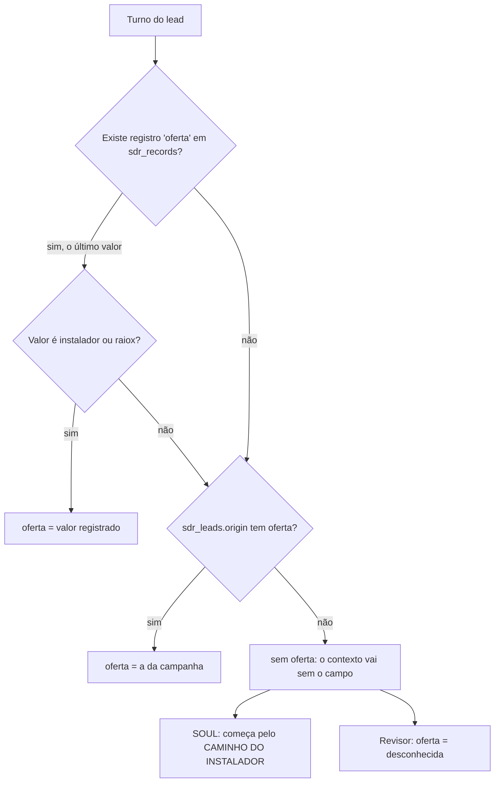
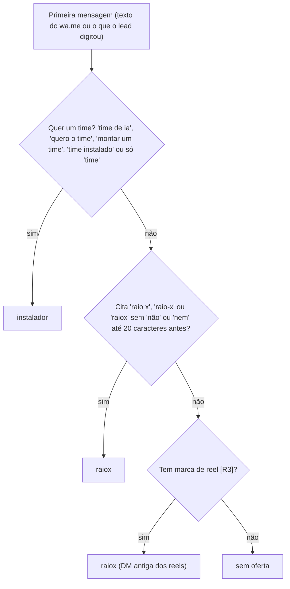
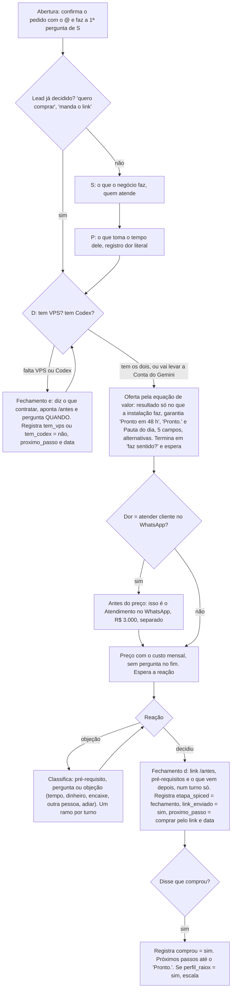
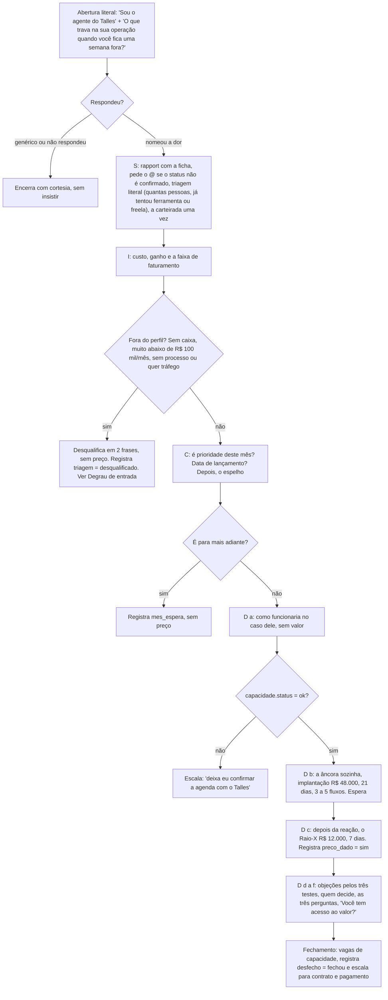
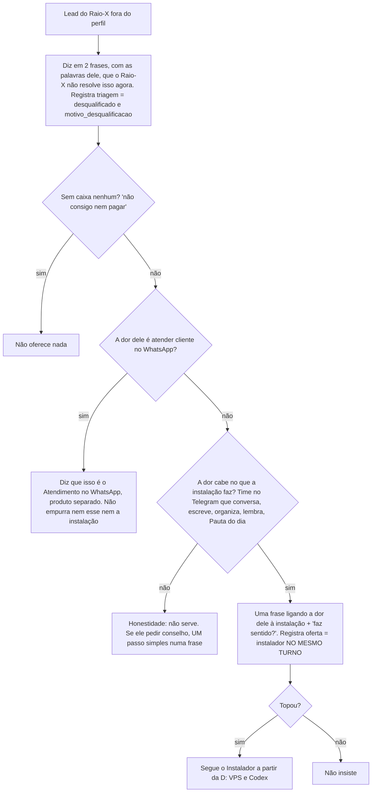
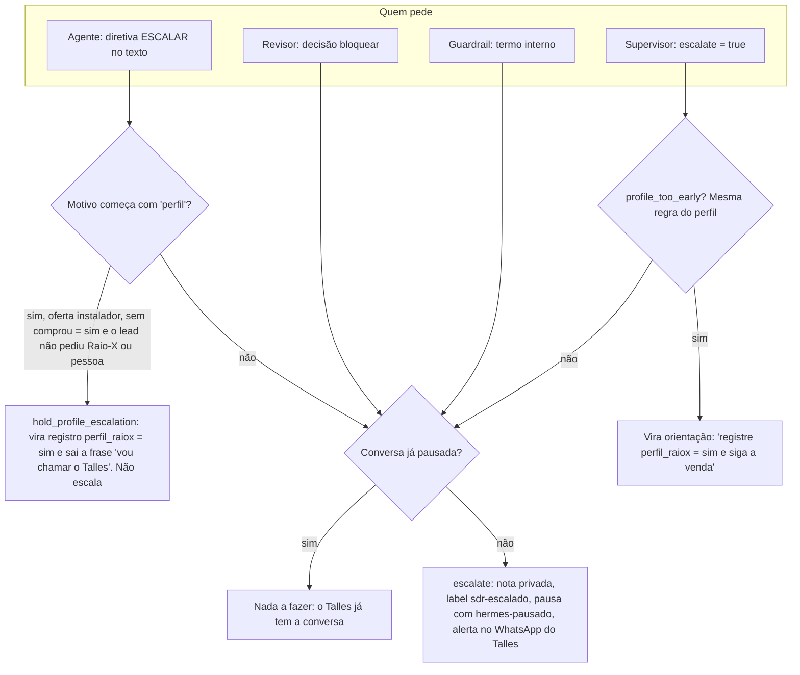
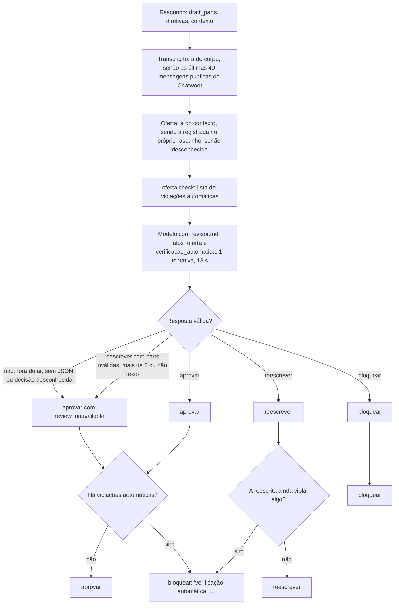
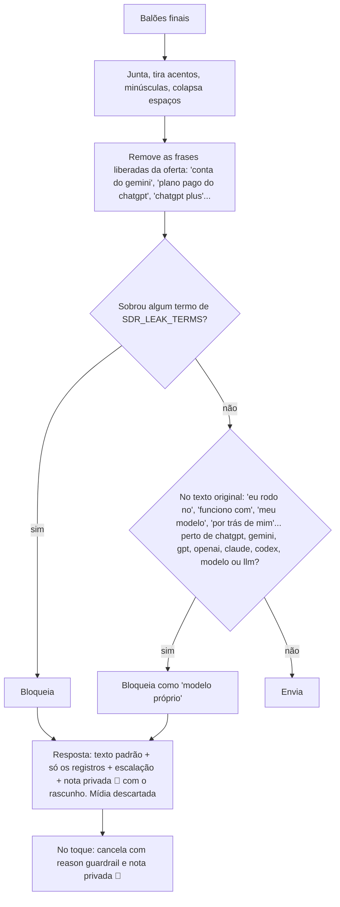
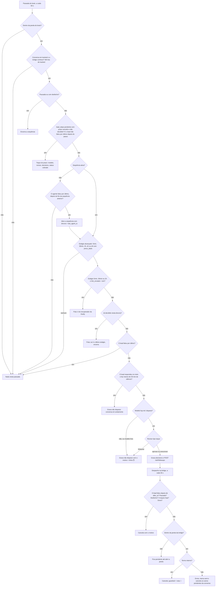
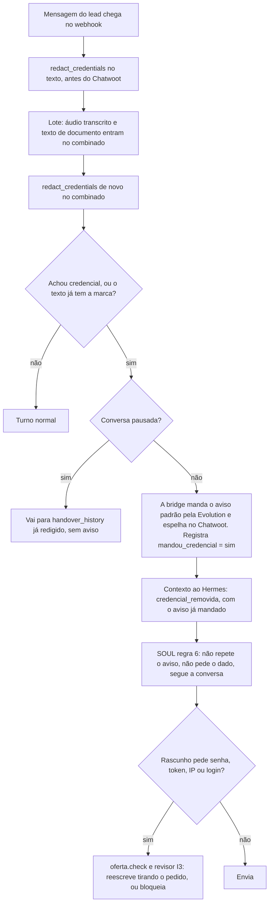

# Árvores de decisão do agente

> **Para que serve:** mostrar, em forma de árvore, cada decisão que o sistema toma sobre um lead: qual oferta, qual passo do roteiro, quando dar preço e link, quando escalar, o que o revisor aprova, o que o guardrail barra, quando sai um follow-up e o que fazer com uma credencial.
> **Data:** 07/10/2026. Retrato de produção (SOUL v13 em `hermes/volume-dados/SOUL.md`, idêntico a `hermes-sdr/SOUL.md`; bridge `sdr-v13`; brain `sdr-brain:v3`).
> **Fontes:** decisões de código citadas pela função; decisões do modelo citadas pela seção do SOUL ou do prompt (`sdr-brain/prompts/*.md`). Uma regra do SOUL é instrução ao modelo e não tem garantia de execução. Uma regra de código é determinística. Cada árvore diz qual é qual.

**Nome do produto de R$ 100.** No SOUL e no `ofertas.json` de produção, o bump de R$ 100 ainda se chama **"Conta do Gemini"**; o checkout o mostra como "Assinatura Gemini One". A cópia de trabalho em `C:\Users\talle\orca\agente-sdr` já trocou para **"1 Ano de Tokens"** no SOUL, em `sdr-brain/oferta.py`, em `sdr-brain/app.py` (texto do passo automático) e em `bridge-src/sdr.py`, onde "gemini" deixou de ser termo de vazamento. Essa troca **ainda não subiu**. Este documento descreve o que está no ar e usa "Conta do Gemini".

---

## 1. Roteamento da oferta

### 1.1 Qual oferta vale neste turno (código)

`sdr.lead_offer` é chamada por `sdr.lead_state` a cada turno e lê os registros e a origem.

- **Precedência:** o registro do agente, `[[REGISTRO: oferta = …]]`, vence a campanha. Entre registros vale o último (`lead_state` monta um dicionário em ordem de criação).
- Na primeira mensagem, `record_offer_from_origin` já grava a oferta da campanha **como registro**. Por isso o agente só muda de oferta registrando outra.
- **No revisor** (`run_review`): se o contexto não traz oferta, mas o rascunho registra uma, o revisor usa a do rascunho.
- **No FUP** (`followup_once`): vale `oferta.current_offer(context)` e, se faltar, o registro.

### 1.2 Oferta a partir do texto da primeira mensagem (código)

A função é `sdr.offer_from_text`, chamada por `sdr.origin_from_text`. O texto é comparado sem acento e em minúsculas.

- O mesmo `origin_from_text` extrai `instagram` (o primeiro `@handle`, ignorando `@there` e `@username`), `peca` (`[R\d+]`) e `canal = instagram`.
- **"Querer o time" vence a palavra citada.** "não quero raio-x, quero o time" e "vi o raio x e quero montar um time" dão `instalador` (`test_sdr.test_what_the_person_wants_wins_over_the_word_she_cites`).
- **Situação de hoje** (MAPA, seção 5): a palavra "time" está na campanha `raiox`. Quem comenta TIME chega com "…quero saber mais sobre o Raio-X" e entra como `raiox`. A mudança para o Instalador depende de o agente registrar `oferta = instalador` quando a pessoa diz que quer o time.

### 1.3 Quando o modelo deve trocar a oferta (SOUL)

Seção "DUAS OFERTAS, UM FUNIL SÓ" do SOUL:

- Sem `oferta`, começa pelo Instalador. Nunca abre com o Raio-X nem pergunta "time ou Raio-X?". O revisor reescreve isso; veja "QUAL OFERTA" em `revisor.md`.
- Só é `raiox` quando a pessoa pede o Raio-X ou pede que o Talles olhe a operação inteira **sem falar em time**.
- Ao descobrir a oferta, o agente registra `[[REGISTRO: oferta = instalador|raiox]]`.
- **Degrau de entrada:** quando o Raio-X desqualifica a pessoa e o agente oferece a instalação, ele registra `oferta = instalador` **no mesmo turno** (seção 3).

---

## 2. Roteiro SPICED por oferta (SOUL)

As letras são as mesmas nas duas ofertas: S situação, P dor, I impacto, C evento crítico, D decisão. Cada uma tem o seu registro: `situacao`, `dor` (citação literal), `impacto`, `evento_critico`, `decisao`, e no Instalador `tem_vps` e `tem_codex`. O agente também registra `etapa_spiced` ao mudar de letra. Vale **um passo por turno e uma pergunta por vez**. O supervisor recebe as letras que faltam por `oferta.spiced_state`.

### 2.1 Caminho do Instalador

**Quando dar o preço**

- Quando o lead pergunta, em qualquer momento. Se faltar S, P ou D, o agente dá o preço, porque é pergunta dele, e volta para a letra que falta (SOUL, "O PREÇO").
- Por iniciativa do agente, só depois da equação de valor. Regra I6 do revisor: na primeira vez que o preço aparece por iniciativa do agente, o resultado e o esforço precisam ter vindo antes.
- Preço uma vez por turno, sempre com o custo mensal (I8). As três formas estão em `ofertas.instalador.custo_mensal` e no SOUL:
  - **com Codex:** "A instalação é R$ 47, pagamento único. Por fora ficam a VPS, cerca de R$ 119 por mês, e o Codex, cerca de R$ 100 por mês…"
  - **com a Conta do Gemini:** a Conta do Gemini custa R$ 100 uma vez, e por mês fica só a VPS. Para quem vai levar a Conta do Gemini, o agente não cita o Codex.
  - **já tem o Codex:** por mês fica só a VPS. O Codex é o plano que ele já paga.
- O turno do preço **termina no preço**, sem pergunta (exceção na regra C8 do revisor).

**Quando mandar o link `https://instalador.talles.dev/antes`**

- Só com S, P e D (VPS e Codex, ou a Conta do Gemini) no histórico ou no rascunho (I1).
- Exceção: o lead pediu o link ou disse que quer comprar. Aí só D é obrigatório.
- O link vai junto com os pré-requisitos e com "o que vem depois" (área do cliente, 5 campos, "Pronto." em até 48 h). Isso conta como um passo só (C7).
- **No código**, `oferta.check` só aceita links do host `instalador.talles.dev`. Qualquer outro link é violação automática.

**Pré-requisitos** (`ofertas.instalador.pre_requisitos`; SOUL, "O QUE É")

- **VPS:** obrigatória para todos. Ubuntu, 8 GB de RAM, referência Hostinger KVM2, cerca de R$ 119 por mês, no nome do cliente. A regra I7 do revisor proíbe dizer "4 GB".
- **IA, uma das duas:**
  - **Codex:** plano pago do ChatGPT, Plus ou maior, cerca de R$ 100 por mês. Conta grátis não funciona.
  - **Conta do Gemini:** bump de R$ 100, pago uma vez, na compra. Substitui o Codex **só** nesse caso. O agente não promete por quanto tempo ela dura: `oferta.check` barra frases como "a Conta do Gemini é vitalícia, por 1 ano…". Quem já comprou sem ela recebe o link avulso pelo Talles (escalação).
- "Não tenho VPS" e "não tenho Codex" são **pré-requisito, não objeção**. O agente diz o que contratar e pergunta **quando** (I2).
- **No brain** (`record_step`), `tem_vps = não` ou `tem_codex = não` sem data cria sozinho o passo "conferir se já contratou…" para o dia seguinte, e isso gera um toque de prazo.

**O que nunca aparece antes da compra registrada** (`comprou = sim`): Raio-X, Copiar a minha operação, os preços deles e os números de cases.

- O código barra no Instalador sem compra: `oferta.check` (`UPPER_STEP_RE`), e os preços de `degraus_acima` ficam de fora dos valores permitidos (`offer_amounts(..., upper_steps=False)`).

### 2.2 Caminho do Raio-X

**Quando dar o preço** (regras R1 a R4 do SOUL, X1, X2, X5 e X6 do revisor)

- Só depois de P (dor concreta), I (custo dito por ele e faturamento dentro do perfil) e C (quer resolver agora).
- Se ele pede antes, o agente adia uma vez ("te passo o número já já. Antes, …"). Se ele pede de novo, vai ao preço.
- Preço e vagas só com `capacidade.status = "ok"`. Vagas = `capacidade.vagas_restantes`; o total do mês = `vagas_total`.
- `sdr.capacity` devolve `desatualizado` se o arquivo tem mais de 7 dias, e `desconhecido` se ele falta ou está quebrado. Também calcula `pode_oferecer_este_mes`: falso quando não há vaga ou quando `horas_comprometidas` passa de `horas_limite`.
- R$ 48.000 (a implantação) sempre **antes** de R$ 12.000, em respostas separadas. A âncora é a implantação, nunca o "Copiar a minha operação". `oferta.check` (`COPIAR_SWAP_RE`) acusa quem troca um pelo outro.

### 2.3 Fora do roteiro, nas duas ofertas

- **Primeira mensagem:** sempre "Sou o agente do Talles" (regra 1 do SOUL).
- **Despedida já feita** e o lead manda só obrigado ou emoji: a resposta é `[[SILENCIO]]`. Nada é enviado e o revisor é pulado, porque não há balões.
- **Próximo passo:** depois de toda troca que muda algo, registrar `proximo_passo` e `proximo_passo_em` (AAAA-MM-DD ou AAAA-MM-DDTHH:MM). O agente nunca promete contato. `oferta.check` (`CONTACT_PROMISE_RE`) barra "te chamo", "volto a te chamar", "passo aqui".

---

## 3. Degrau de entrada: o desqualificado do Raio-X

Decisão do Talles de 06/10. Está no SOUL, em "S, SITUAÇÃO E PERFIL", na regra X4 do revisor e em `oferta.check`.

**No código** (`oferta.check`), com `oferta = raiox` e `triagem = desqualificado` (`oferta.disqualified`), os valores do Instalador sem os degraus de cima também passam a ser permitidos. Assim, o preço da instalação dito no turno do degrau não é barrado como "valor que não existe".

O revisor só reprova (X4) quando o rascunho:
- empurra a instalação para uma dor que ela não resolve;
- insiste depois de um não;
- oferece algo a quem está sem caixa nenhum.

---

## 4. Quando escalar ao Talles

### 4.1 Quem pode pedir a escalação

- `hold_profile_escalation` (bridge) e `profile_too_early` (brain) usam o mesmo teste para saber se o lead pediu:
  - "raio x", "copiar a minha opera…", "humano", "falar com o Talles, uma pessoa, alguém ou vocês", "atendente".
- Se o rascunho só dizia que ia chamar o Talles e não sobra nada depois de tirar essa frase, a escalação **é mantida** ("nothing else to say").

### 4.2 Os motivos de escalar no SOUL e no supervisor

| Motivo | Instalador | Raio-X | Fonte |
|---|---|---|---|
| Pediu uma pessoa, o Raio-X ou o Copiar | escala na hora, antes ou depois da compra, sem preço | escala | SOUL, "A ESCADA" e "QUANDO CHAMAR O TALLES"; `supervisor.md` |
| Irritado | escala | escala | SOUL; `supervisor.md` |
| Reembolso ou reclamação de compra | escala | escala | SOUL; `supervisor.md` |
| Dúvida técnica fora do roteiro (outro servidor, outro sistema, integração) | escala | escopo fora que precisa de resposta agora | SOUL; `supervisor.md` |
| Travou para contratar a VPS ou o Codex | escala (`[[ESCALAR: travou para contratar VPS ou Codex \| …]]`) | — | SOUL, "O QUE É" |
| Quer o link avulso da Conta do Gemini depois da compra | escala | — | SOUL, "O QUE É" |
| Perfil para os degraus de cima | **só depois** de `comprou = sim`; antes, só o registro `perfil_raiox` | — | SOUL, "A ESCADA"; código acima |
| "Vou pensar" | **não** escala: pergunta o que ele quer pensar e combina uma data | escala ("preciso pensar", "vou ver" sem data, indecisão, "não" persistente na pergunta de confiança, muda de assunto) | SOUL; `supervisor.md` |
| Capacidade incerta na hora do preço | — | escala ("deixa eu confirmar a agenda…") | SOUL R1; revisor X2 |
| Fechamento | — | escala com `desfecho = fechou` para contrato e pagamento | SOUL, "D, DECISÃO" |
| Objeção sobre ele (insegurança, já foi queimado com critério escrito) | — | escala (teste 3) | SOUL, "OBJEÇÕES DO RAIO-X" |
| Sigilo ou nome de cliente no rascunho | revisor bloqueia, e isso escala | idem | `revisor.md` C1 e C2 |
| Violação dura que a reescrita não corrigiu | bloqueio automático, e isso escala | idem | `enforce_offer_rules` |
| Termo interno no texto final | guardrail, e isso escala | idem | `deliver_agent_reply` |

Depois de escalar, o SOUL manda **parar**. A bridge garante a parada, porque pausa a conversa.

---

## 5. O revisor (`POST /review`)

### 5.1 Fluxo da decisão (código, `sdr-brain/app.py`)

**O que a bridge faz com cada decisão** (`review_reply`)

- `aprovar`: segue.
- `reescrever`: troca os balões.
- `bloquear`: resposta padrão + escalação.
- Erro ou timeout (22 s): segue com o rascunho.

O brain escreve no Chatwoot a linha ✏️ ou ⛔ quando a decisão não é `aprovar` e o motivo não é `review_unavailable`.

### 5.2 Regras que o modelo aplica (`prompts/revisor.md`)

**Princípios**

- **Na dúvida, aprova.**
- **Bloquear** só para C1 (sigilo) e C2 (nome de cliente). Todo o resto se conserta reescrevendo.
- **A reescrita só corta ou conserta**, nunca acrescenta preço, link, âncora ou passo. A única exceção é I8 (acrescentar o custo mensal).
- Diretivas `[[…]]` devem ficar idênticas.
- **Toque** (`tipo = toque`): não aplica C5 e devolve uma parte só.

**Regras comuns**

| Regra | Conteúdo | Ação |
|---|---|---|
| C1 | Sigilo: modelo, IA, empresa, plataforma, prompt, contexto. Falar do Codex, do plano pago do ChatGPT e da Conta do Gemini **do cliente** não é sigilo. | bloquear |
| C2 | Nome de cliente ou de operação anterior | bloquear |
| C3 | Curso, aula, mentoria, "eu te ensino" | reescrever |
| C4 | Concorrente e a lista `{{PROIBIDOS}}`, que vem de `oferta.forbidden_list()` | reescrever |
| C5 | Pergunta direta do lead respondida primeiro | reescrever |
| C6 | No máximo 3 mensagens curtas | reescrever |
| C7 | Um passo por turno (o link do Instalador com pré-requisitos e o depois conta como um) | reescrever |
| C8 | Termina em pergunta binária, salvo escalação, despedida e o preço do Instalador | reescrever |
| C9 | Voz "eu / o Talles", nunca "nós" ou "a gente" | reescrever |
| C10 | Nada fora dos fatos: logística inventada, resultado em dinheiro, promessa de contato | reescrever |
| C11 | Nada de dossiê que não está no contexto (a ficha pode) | reescrever |
| C12 | Objeção no ramo certo, começando por reconhecer | reescrever |
| C13 | Escassez só com dado real: 15 por dia, ou `vagas_restantes` | reescrever |

**Instalador**

| Regra | Conteúdo |
|---|---|
| I1 | Link só com S, P e D (exceção: o lead pediu) |
| I2 | VPS ou Codex é pré-requisito, não objeção |
| I3 | Nunca pede senha, token, IP ou usuário |
| I4 | Sem promessa de faturamento, sem desconto, prazo de até 48 h, garantia como nos fatos |
| I5 | Raio-X, Copiar e cases só depois de `comprou = sim` |
| I6 | Equação de valor antes do primeiro preço por iniciativa do agente |
| I7 | Sem vídeo, sem tela, sem "4 GB" ou "módulo", sem duração da Conta do Gemini |
| I8 | Preço com o custo mensal |
| I9 | A instalação não é atendimento no WhatsApp |

**Raio-X**

| Regra | Conteúdo |
|---|---|
| X1 | R$ 12.000 só depois de R$ 48.000 |
| X2 | Preço e vagas só com capacidade `ok` |
| X3 | Só os números autorizados ("mais de" só nos 300 mil) |
| X4 | Fora do perfil, sem preço do Raio-X (com a exceção do degrau de entrada) |
| X5 | Carteirada, dossiê, âncora e Raio-X nunca juntos |
| X6 | SPICED (P, I, C) antes de qualquer valor; exceção: pediu o preço duas vezes |
| X7 | Os dois produtos de R$ 48.000 não se trocam |

As frases literais do roteiro do Raio-X **nunca** são reescritas.

### 5.3 Checagens automáticas (`oferta.check`, determinísticas)

Toda violação encontrada vira um item de `verificacao_automatica`. Se ela sobreviver à decisão do modelo, a resposta vira `bloquear`.

| Checagem | Vale quando | Como detecta |
|---|---|---|
| Nome ou frase proibida (Naia, Squad, Avalanche, Denderson; "Bom dia, Naia", "Pare de contratar"…; Rafael, Juliana, Davi, Paulo, Jonathan) | sempre | `forbidden_hits`. Um nome que o próprio lead usou não conta. |
| Valor que não existe na oferta | sempre que há valores permitidos | `_price_issues`. Os valores vêm de `ofertas.json`: **instalador** sem os degraus de cima antes da compra; **raiox** com tudo do Raio-X, mais o Instalador sem degraus se desqualificado; **sem oferta**, os dois. Um valor dito pelo lead passa só quando aparece como custo **dele** ("você paga R$ 2.000") e não como preço nosso. |
| Preço errado para o produto ("o Raio-X é R$ 9.000") | sempre | `_product_price_issues` com `product_prices` |
| Link fora da oferta | sempre | todo host diferente de `instalador.talles.dev` |
| Pede senha, token, IP, login ou dado do servidor | sempre | `_asks_for_secret`. Dizer que o dado vai "no formulário" não conta, nem a pergunta do lead "é seguro passar a senha?". |
| Promessa de faturamento | sempre | `REVENUE_PROMISE_RE`, salvo frase negada |
| Desconto ou cupom | sempre | `DISCOUNT_RE` |
| Promessa de contato numa data | sempre | `CONTACT_PROMISE_RE` |
| Duração da Conta do Gemini | sempre | `GEMINI_DURATION_RE` |
| Implantação trocada pelo Copiar | sempre | `COPIAR_SWAP_RE` |
| Prazo abaixo de 48 h ("em 24 h", "amanhã pronto") | oferta ≠ raiox | `FAST_DEADLINE_RE` |
| Diz que existe vídeo | oferta ≠ raiox | `VIDEO_RE` |
| Número de case do Raio-X | oferta ≠ raiox | `RAIOX_PROOF_RE` |
| Instalação vendida como atendimento no WhatsApp | oferta ≠ raiox | `WHATSAPP_SERVICE_RE`, salvo se a frase cita "Atendimento no WhatsApp" ou R$ 3.000 |
| Raio-X ou Copiar antes da compra | oferta = instalador e sem `comprou = sim` | `UPPER_STEP_RE` |

A regex `_negated` ignora uma violação quando há "não", "nunca", "nem", "jamais" ou "sem" antes dela na mesma oração.

---

## 6. Guardrail da bridge (termos de vazamento)

É a última barreira antes do envio, e é determinística. Roda em toda resposta, depois do revisor (`deliver_agent_reply`), e em todo toque (`process_followups_once`).

**Termos em produção** (padrão de `SDR_LEAK_TERMS` em `sdr.py`): `hermes`, `nous research`, `nousresearch`, `omniroute`, `antigravity`, `gemini`, `openai`, `chatgpt`, `gpt-`, `claude`, `anthropic`, `chatwoot`, `evolution api`, `evolution go`, `evogo`, `openreply`, `portainer`, `traefik`, `docker`, `system prompt`, `soul.md`, `/opt/`, `evento_estruturado`, `x-hermes`, `api_server`, `skill_view`, `skills_list`, `skill_manage`.

- Termos que começam e terminam em letra ou número exigem fronteira de palavra. Os outros, como `/opt/` e `gpt-`, casam como substring.
- **Frases liberadas** (`SDR_OFFER_PHRASES`): "conta do gemini", "oauth do gemini", "assinatura do gemini", "assinatura gemini one", "gemini one", "seu gemini", "sua conta do gemini", "gemini advanced", "plano pago do chatgpt", "plano do chatgpt", "assinatura do chatgpt", "conta do chatgpt", "conta gratis do chatgpt", "conta gratuita do chatgpt", "seu chatgpt", "chatgpt plus", "chatgpt pro".
- **Em produção**, "Gemini" dito sozinho ("os tokens são do Gemini") **é bloqueado**. A cópia de trabalho tira `gemini` da lista e deixa a frase passar, mas isso ainda não subiu.
- Antes do guardrail, `sdr.parse_reply` já tirou todo `[[…]]`, e `extract_hermes_media` tirou os `MEDIA:`. Mensagens que o Talles escreve no Chatwoot **não** passam pelo guardrail nem pelo `plain_style`.

---

## 7. Follow-up: disparar ou não

Juntam-se aqui as três camadas: o laço do brain, o modelo (`fup.md`) e o despacho da bridge.

**Quando o modelo não deve disparar** (`fup.md`, "NÃO DISPARE"):

- o lead disse que responde depois, marcou um dia ou horário que ainda não chegou, pediu para não ser contatado ou já disse não;
- a última mensagem do agente foi despedida, encerramento ou escalação;
- o assunto se resolveu: decisão tomada, passo combinado com data futura ou dúvida esclarecida sem pergunta aberta.

No toque do prazo, o modelo também não dispara se a transcrição mostra que o passo já aconteceu ou que o lead mudou a data.

**Conteúdo do toque** (`fup.md`)

- Cada estágio tem uma intensidade:
  - `5min`: leve;
  - `30min`: traz valor novo;
  - `2h`: avança e oferece uma saída honesta;
  - `d1`: um ângulo novo;
  - `d4`: depois do preço. No Raio-X, a vaga do mês com o número do contexto. No Instalador, uma saída honesta, sem escassez.
- O toque nunca diz "follow-up", "lembrete", "sumiu".
- Depois do preço, não repete o preço.
- Depois do link, não repete o que a Kiwify cobra.
- Termina em pergunta binária.

---

## 8. Credencial enviada na conversa

**O que conta como credencial** (`sdr.redact_credentials`; a mesma regra existe em `oferta.redact_credentials`)

- bloco `-----BEGIN … PRIVATE KEY-----`;
- token de bot do Telegram (`dígitos:` + 30 caracteres ou mais);
- chaves que começam com `sk`, `pk`, `ghp`, `gho`, `xoxb` ou `xoxp` seguidos de `-` ou `_` e 16 caracteres ou mais;
- qualquer IPv4;
- valor rotulado: `senha`, `password`, `pass`, `pwd`, `token`, `chave`, `api key`, `usuário`, `user` ou `login`, seguido de `:`, `=`, "é" ou espaço, e de um valor.
  - Com `:` ou `=` o valor é sempre redigido.
  - Sem eles, só se o valor tiver número ou símbolo, ou se tiver 6 caracteres ou mais misturando maiúsculas e minúsculas.

O trecho vira `[credencial removida]`.

**O aviso padrão** (`SDR_CREDENTIAL_NOTICE`, igual à regra 6 do SOUL): "Apaga essa mensagem, por favor, e depois troca essa senha. Isso vai só no formulário cifrado, depois da compra."

- Quem manda é a **bridge**, não o Hermes (`send_credential_notice`).
- A mensagem atualiza `last_agent_ts` e grava o registro na bridge e no brain.

**Onde a credencial ainda fica** (limites lidos no código)

- **No WhatsApp do lead** e no **Postgres da Evolution** (`DATABASE_SAVE_MESSAGES=true`). A redação só acontece na bridge, por isso o aviso pede ao lead que apague a mensagem e troque a senha.
- **Imagem** (print de senha): não passa por redação. Vai ao Hermes como imagem, ao Chatwoot como anexo e a `/data/media`.
- **Mensagem editada:** o texto novo entra redigido no Chatwoot, mas o payload bruto da edição fica em `event_history` (`record_event`).
- **Conversa pausada:** o aviso **não** é enviado, porque a pausa é checada antes do aviso em `hermes_batch_worker`. O texto fica redigido, e o operador vê a marca.
- **O brain** redige de novo as mensagens do lead que lê do Chatwoot (`compact_transcript`), para cobrir mensagens antigas.

---

## O que verificar quando der problema

1. **O agente falou da oferta errada.** Compare `sdr_records` (campo `oferta`, o último valor) com `sdr_leads.origin`. Lembre que hoje quem comenta TIME chega com o texto do Raio-X: o agente precisa registrar `oferta = instalador`.
2. **Preço ou link barrado sem motivo aparente.** Leia a linha ⛔ no Chatwoot ("verificação automática: …") e confira se `ofertas.json`, no bind `/sdr`, tem o valor, e se `comprou` ou `triagem` estão registrados como o código espera ("sim" e "desqualificado").
3. **O agente não escalou quando devia.** Procure uma `[[ESCALAR: perfil…]]` segurada (`hold_profile_escalation` no log: "profile escalation held") e a label `hermes-pausado`, que já pausada torna a escalação um no-op.
4. **Escalação por guardrail com uma frase legítima.** Veja a nota 🛑. Se o termo foi "gemini" fora das frases liberadas, é o caso conhecido que só a cópia de trabalho corrige.
5. **Toque não saiu.** Siga a árvore 7 de cima para baixo; a linha ⏱️ no Chatwoot diz o motivo do brain, e `sdr_followups.reason` diz o da bridge.
6. **Credencial apareceu em algum lugar.** Confira se veio em imagem, numa edição de mensagem ou com a conversa pausada, que são os limites conhecidos. Peça ao lead para apagar a mensagem e trocar a senha.
