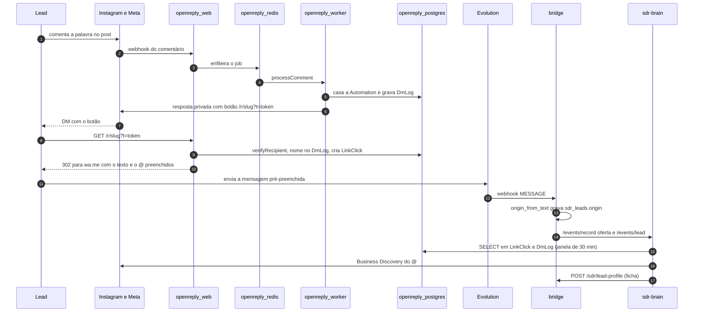
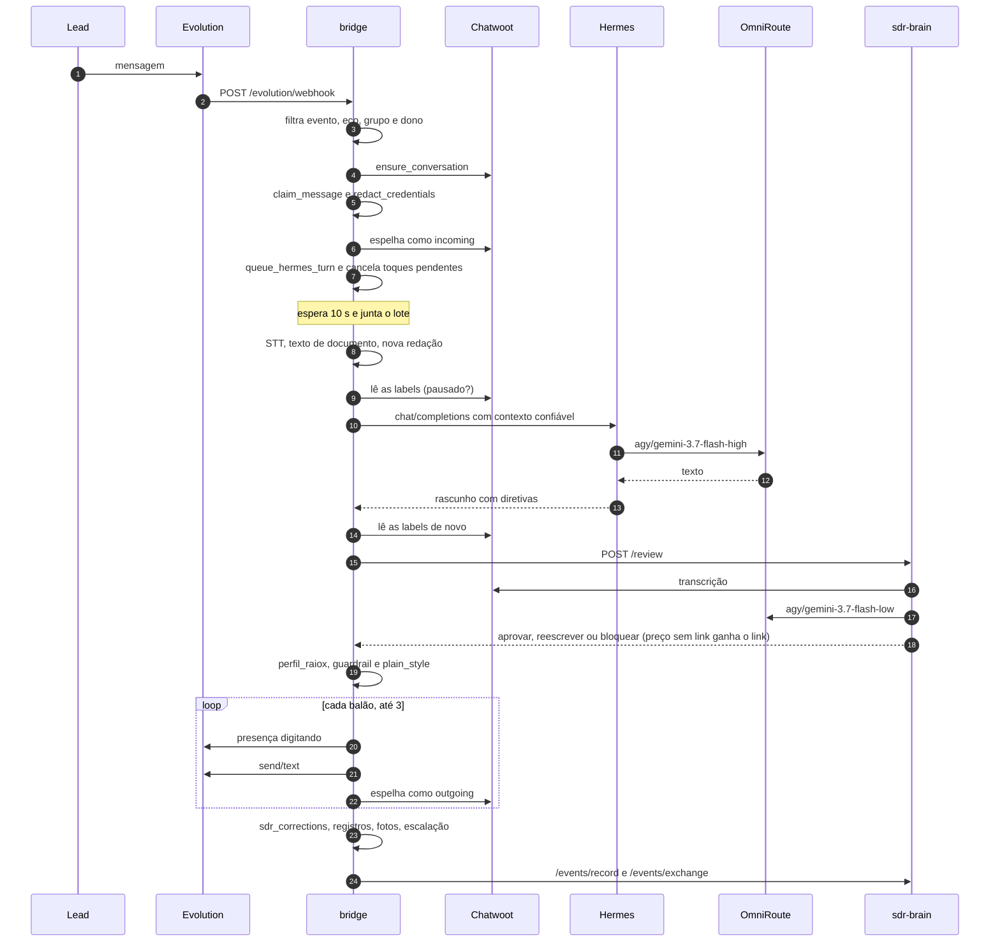
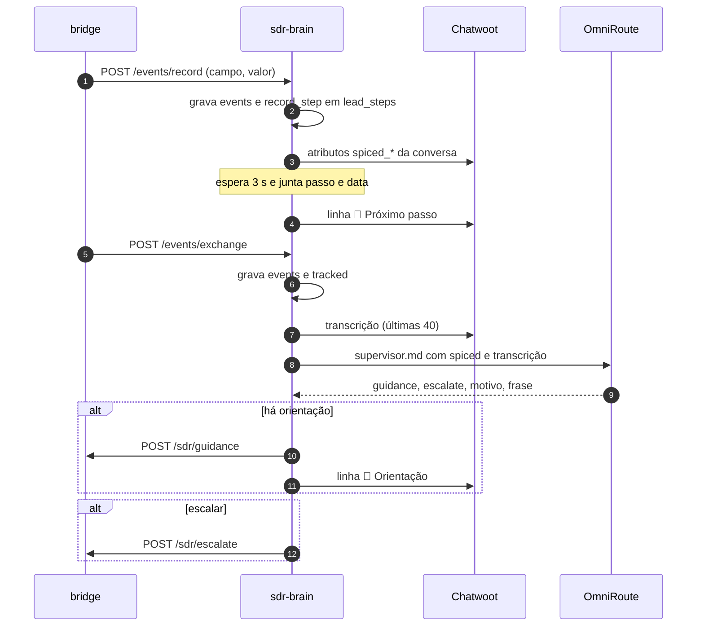
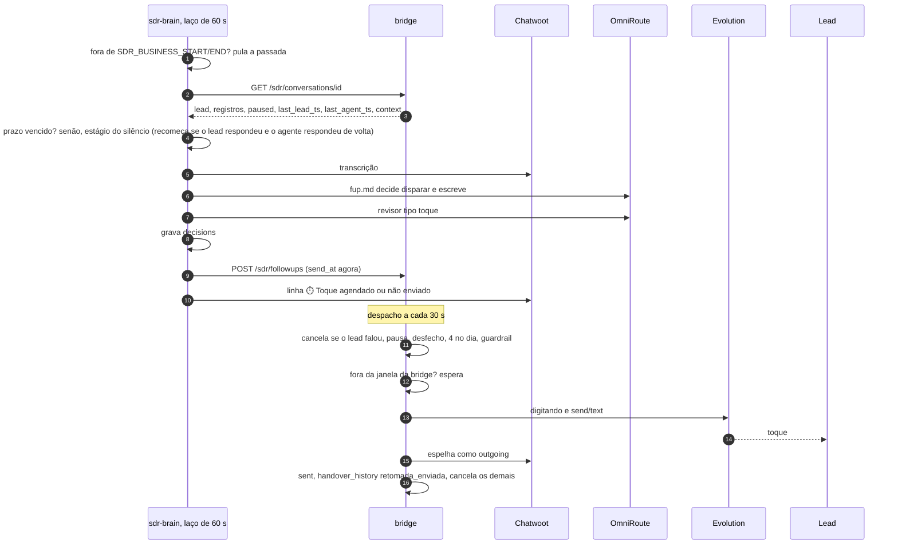
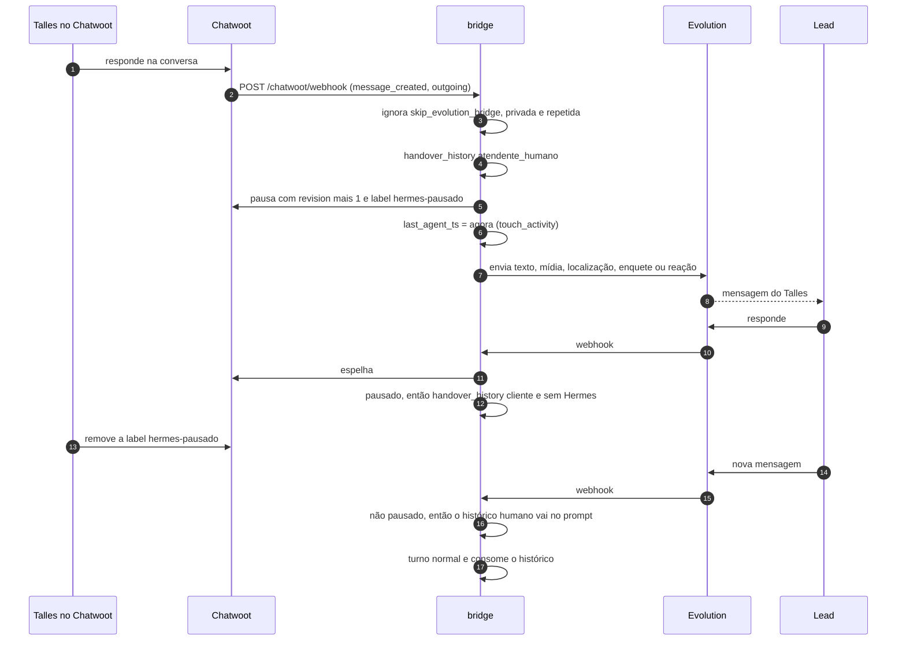

# Ciclo de vida das requisições

> **Para que serve:** seguir cada tipo de requisição do começo ao fim, com os tempos, os timeouts e o que fica gravado em cada lugar, para saber onde uma mensagem está e por que ela não andou.
> **Data:** 08/10/2026, ~03:45 (BRT), depois da sessão TSX-77. Retrato de produção (bridge `sdr-v13.1`, brain `sdr-brain:v3.2`, OpenReply `sdr-v2`).
> **Fontes:** `bridge-src/app.py`, `sdr.py`, `handover.py`, `sdr-brain/app.py`, `crm.py`, `enrichment.py`, `oferta.py`, `prompts/*.md` e `openreply/patches/*`. Cada passo cita a função. O que não está no código aparece como **não verificado**.

Topologia, redes e tabelas estão em [`TOPOLOGIA.md`](TOPOLOGIA.md). As regras de decisão estão em [`ARVORES-DE-DECISAO.md`](ARVORES-DE-DECISAO.md).

---

## Tempos e limites de referência

| O quê | Valor | Onde |
|---|---|---|
| Acúmulo de mensagens antes do turno | 10 s, contados do início do lote | `HERMES_MESSAGE_DEBOUNCE_SECONDS`, `hermes_batch_worker` |
| Turnos simultâneos no Hermes | 8 | `HERMES_MAX_CONCURRENCY`, semáforo `hermes_slots` |
| Janela de nova tentativa no 429 | 180 s; espera de 0,5 a 10 s entre tentativas (respeita `Retry-After`) | `HERMES_429_RETRY_SECONDS`, `ask_hermes` |
| Timeout de cada chamada ao Hermes | 180 s | `httpx.AsyncClient(timeout=180)` em `ask_hermes` |
| Espera da bridge pelo revisor | 22 s em produção (12 s no código) | `SDR_REVIEW_TIMEOUT`, `review_reply`; produção segundo `HERMES_OPS_LOG.md` |
| Tentativa do revisor no modelo | 1 tentativa de 18 s | `SDR_REVIEW_LLM_TIMEOUT`, `run_review` |
| Supervisor e FUP no modelo | 2 tentativas de 12 s | `ask_llm` (padrões) |
| "Digitando…" por balão | `len/30` segundos, de 1,5 a 6 s | `sdr.typing_seconds` |
| Eventos para o brain | 1 tentativa, timeout de 5 s, sem fila | `brain_event` |
| Chamadas do brain à bridge | timeout de 8 s (de 5 s no `GET` do FUP) | `bridge_post`, `followup_once` |
| Laço da outbox | a cada 5 s; espera `min(900, 2^(n+1))` s após cada falha | `outbox_worker`, `_outbox_failed` |
| Despacho de toques (bridge) | a cada 30 s | `followup_worker` |
| Laço de decisão do FUP (brain) | a cada 60 s | `followup_loop` |
| Deduplicação de mensagem da Evolution | 24 h | `app.db` apaga `messages` com mais de 86.400 s |
| Janela de identificação no Instagram | 30 min antes da 1ª mensagem (+60 s depois) | `SDR_MATCH_WINDOW_SECONDS`, `window_candidates` |

---

## (a) Comentário no Instagram → DM → clique → primeira mensagem no WhatsApp

**Passo a passo**

1. **Comentário e DM** (OpenReply, fora deste repositório, base `5760181` + patches).
   - A Meta chama `openreply.talles.dev/api/webhook` e o worker processa o comentário.
   - O casamento de palavra e campanha está em `Automation`. A regra de palavra inteira e a lista de palavras da campanha `raiox` vêm do MAPA, item 2: **não verificado** no código.
   - O worker manda a resposta privada com até 3 botões. O link é montado por `buildLinkButtons` e `buildTrackedUrl(slug, base, recipientId)`, com `recipientId` = IGSID de quem comentou (patch 0001, `lib/queue/dm-worker.ts`).
   - **Gravado:** `DmLog`, com `commenterId`, `commenterName`, texto, palavra e status. Quando a pessoa só mandou DM (`processMessage`), o @ vem de `getUserUsername` (Graph API).
2. **Link assinado.**
   - O link é `https://openreply.talles.dev/r/<slug>?t=<base64url(IGSID)>.<assinatura>`.
   - A assinatura é um HMAC-SHA256 de `slug:IGSID` com `NEXTAUTH_SECRET`, cortado em 16 caracteres (`lib/tracking/recipient.ts`, `signRecipient`).
   - O lead não vê código nenhum no WhatsApp.
3. **Clique** (`app/r/[slug]/route.ts`).
   - Slug desconhecido vai para a home pública (`NEXTAUTH_URL`, patch 0002).
   - Slug válido: `verifyRecipient` confere a assinatura, busca `commenterName` no `DmLog` da mesma automação e cria um `LinkClick` com `recipientId` e `recipientName` (e também `ipHash`, `userAgent`, `referrer`).
   - Depois redireciona com 302 para `personalizeDestination(destinationUrl, nome)`, que troca `{username}` ou `%7Busername%7D` pelo @ codificado. Sem @ conhecido, o marcador e o `@` à frente somem.
4. **Texto pré-preenchido.**
   - Hoje a palavra "time" está na campanha `raiox`. Então quem comenta TIME chega com "E aí! Sou o @x e quero saber mais sobre o Raio-X" (MAPA, seção 5).
   - O texto da campanha do Instalador ("…quero o meu Time de IA instalado") está no plano de deploy (`agente-sdr/DEPLOY.md`, passo 6). Se já foi aplicado: **não verificado**.
5. **Primeira mensagem na bridge.** Ela segue o fluxo (b). No primeiro lote, `sdr.remember_lead` grava `sdr_leads` com `origin = origin_from_text(texto)`, que traz o `instagram` (o @), a `peca` (marca `[R3]`), `canal` e `oferta`.
   - Se houver `oferta`, `record_offer_from_origin` a grava como um registro: em `sdr_records`, no atributo `sdr_oferta` do Chatwoot e em `/events/record` no brain.
   - Em seguida sai `/events/lead` com `origin`, `first_message` e `ts`.
6. **Enriquecimento** (`sdr-brain/app.py`, `enrich` → `enrichment.enrich`, em segundo plano).
   - Busca o nome do contato no Chatwoot.
   - Se não há @ no texto, consulta a janela de 30 min de `LinkClick` (cliques assinados primeiro) e `DmLog` com status `SENT`.
   - `resolve_identity` decide a identidade (veja a árvore em `ARVORES-DE-DECISAO.md`).
   - Para o @ confirmado, busca o histórico no OpenReply e o perfil na Meta (timeout de 10 s; Apify como reserva, 120 s; cache de 7 dias).
   - Entrega a `ficha` à bridge (`/sdr/lead-profile`, tabela `sdr_profiles`).
   - Escreve no Chatwoot a linha "🔎 Instagram @x: …" e os atributos `ig_*` do contato (`report_enrichment`, `crm.update_contact`).
   - **Gravado no brain:** `ig_matches`, `ig_company`, `ig_profiles`.

**Corrida conhecida.** O enriquecimento roda em paralelo ao primeiro turno do Hermes. O primeiro turno normalmente sai **sem** a `ficha`, e ela só entra no contexto do turno seguinte. Isso se deduz da ordem no código: `brain_event` é disparado e esquecido antes de `ask_hermes`.

---

## (b) Mensagem do lead até a resposta

### Diagrama do caminho feliz (texto)

### Passo a passo, com o que é gravado

**1. Webhook** (`evolution_webhook`)

- **Token.** Se `BRIDGE_WEBHOOK_TOKEN` existe e o Bearer não confere, a bridge responde `{"received": false}` (com HTTP 200) e não faz nada.
- **Recibos** (`RECEIPT`, `READ_RECEIPT`, `MESSAGE_STATUS`) vão para `event_history`, e `sync_chatwoot_state` atualiza o status ou apaga a mensagem no Chatwoot. Fim.
- **Descartes.** Saem sem processar: eventos fora da lista, mensagem sem id, `SENDMESSAGE` (envio da própria API), eco (`handover.is_echo`, id em `bridge_outbound`), `@broadcast` e `@newsletter`, e grupos (`BRIDGE_GROUP_POLICY=disabled` por padrão).
- **JID.** O sufixo `:N` sai do JID. Um `@lid` é trocado pelo `SenderAlt`.
- **Dono.** Se o JID é do dono (`sdr.is_owner`), só `#teste` e `#fim` têm efeito (veja (e)). Fora do modo teste, as mensagens do dono são descartadas: nem vão ao Chatwoot.

**2. Conversa no Chatwoot** (`ensure_conversation`)

- Roda sob um lock global.
- Na primeira vez, cria o contato pela API pública do inbox (com `identifier = jid`, telefone e `whatsapp_jid`) e a conversa pela API da conta.
- **Gravado:** `contacts` (`jid`, `source_id`, `conversation_id`, `internal_id`).

**3. Deduplicação** (`claim_message`)

- `INSERT OR IGNORE` em `messages`, numa transação `IMMEDIATE`.
- Mensagem repetida para aqui.

**4. Normalização**

- `payment_event` transforma um pedido de pagamento ou Pix em evento estruturado.
- `text_from_message` extrai o texto. Localização, enquete, reação, edição, botão e template viram texto entre colchetes.
- `quoted_context` prefixa a citação: "[Respondendo à mensagem de …]".
- Para o lead, `sdr.redact_credentials` troca credenciais por `[credencial removida]` **antes** do Chatwoot (veja a árvore de credencial).

**5. Mídia**

- `media_info` decodifica o base64 que a Evolution manda dentro do webhook (`WEBHOOK_FILES=true`).
- Se veio só o envelope, sem base64, a bridge **não** consome o id e espera a segunda cópia da Evolution.
- **Gravado:** o arquivo em `/data/media/` e a linha em `media_history` (`remember_media`).

**6. Espelho**

- `add_chatwoot_message` cria a mensagem `incoming`, com anexo se houver.
- **Gravado:** `messages.chatwoot_id`.
- Se o Chatwoot falha, a bridge apaga a linha de `messages` (libera o id) e devolve erro à Evolution.

**7. Estado e fila**

- Reação, edição e revogação vão para `event_history` e para o Chatwoot, mas **não** abrem turno.
- Uma mensagem normal entra em `queue_hermes_turn`, que atualiza `sdr_activity.last_lead_ts`, cancela os `sdr_followups` pendentes (`reason = lead_message`) e põe a mensagem em `hermes_pending[jid]`, na memória.
- Se não há tarefa para o JID, cria uma `hermes_batch_worker`.

**8. Acúmulo** (`hermes_batch_worker`)

- A tarefa dorme 10 s e depois pega **tudo** que chegou.
- A janela conta do início do lote e **não** reinicia a cada mensagem. O MAPA, seção 4, diz que reinicia, mas o código não faz isso.
- O que chega durante o processamento entra no lote seguinte, depois de mais 10 s.

**9. Montagem do lote**

- Textos são juntados por quebra de linha. Áudios viram "[Transcrição do áudio]: …". Documentos viram "[Texto extraído do documento X]" ou "[OCR do documento X]".
- Se o lote não tem mídia, mas o texto fala de "foto", "áudio", "isso", "essa" etc., a bridge anexa até 3 mídias recentes do JID (600 s) ou do Chatwoot (`recent_local_media`, `recent_chatwoot_media`).
- A redação roda de novo sobre o texto combinado, para pegar senha dita em áudio ou escrita em documento.

**10. Pausa**

- `handover.paused` lê as labels no Chatwoot.
- Se a conversa está pausada, o lote vai para `handover_history` (papel `cliente`) e o turno acaba.

**11. Preparação**

- A bridge guarda a revisão (`handover.revision`) e o histórico não consumido (`handover.context`).
- Na primeira mensagem, chama `remember_lead`, `record_offer_from_origin` e `/events/lead`.
- Se houve credencial, `send_credential_notice` manda o aviso padrão direto pela Evolution e grava `mandou_credencial = sim`.
- Por fim, lê as orientações pendentes (`sdr.pending_guidance`).

**12. Contexto confiável** (`sdr.trusted_context`)

Vai como mensagem `role: system` nesta requisição. Ela não é gravada na sessão, segundo o comentário em `ask_hermes`. Contém:

- `agora`;
- `capacidade` (de `capacidade.json`, ou `desatualizado` ou `desconhecido`);
- `ofertas` (de `ofertas.json`);
- `fotos_aprovadas`;
- `lead`, com `origem`, `ficha`, `registros`, `oferta` e `proximo_passo`;
- `oferta`;
- `mensagens_corrigidas` (as 3 últimas);
- `orientacoes`;
- `credencial_removida`, quando for o caso.

No fim vem um lembrete de sigilo.

**13. Chamada ao Hermes** (`ask_hermes`)

- A sessão vai em `X-Hermes-Session-Id = HERMES_SESSION_PREFIX + jid (+ :testeN)`.
- Imagens de até 5 MB vão como `image_url` com data URL. Áudio, vídeo e documento **não** vão como arquivo.
- Pagamento vai como bloco `[EVENTO_ESTRUTURADO_BRIDGE]` no texto e em `metadata`.
- **Fila:** a chamada espera uma das 8 vagas do semáforo. Um 429 vira espera e nova tentativa por até 180 s, e a vaga fica presa durante as esperas.
- **Gravado** pelo Hermes, na sessão dele: o turno do usuário (com o histórico prefixado) e o rascunho.

**14. Depois da resposta**

- Se a conversa foi pausada ou houve intervenção humana durante a chamada (a revisão mudou), o rascunho é descartado e o lote vai para `handover_history`.
- Se o lead escreveu enquanto o Hermes pensava (`lead_interrupted`, há algo em `hermes_pending`), o rascunho também é descartado. Grava-se `sdr_corrections` (enviado = nada, motivo "interrompida pelo lead"), e o lote volta para a **frente** da fila, para ser respondido junto com a mensagem nova.

**15. Diretivas** (`sdr.parse_reply`)

- `[[ESCALAR: motivo | frase]]`, `[[REGISTRO: campo = valor]]` (o campo precisa casar com `^[a-z][a-z0-9_]{1,39}$`), `[[FOTO: nome]]`, `[[QUEBRA]]`, `[[SILENCIO]]`.
- Qualquer outro `[[…]]` é removido do texto, assim como `[[` ou `]]` soltos.
- Linha em branco ou `[[QUEBRA]]` separam balões. A partir do 3º, tudo vira um balão só (`SDR_MAX_MESSAGES_PER_TURN=3`).
- `MEDIA: caminho` é resolvido dentro de `/hermes-data` (`extract_hermes_media`).

**16. Revisão** (`review_reply`, só se há balões)

- `POST /review` com `draft_parts`, `directives` e `context` (o mesmo de `sdr.context_payload`).
- No brain (`run_review`), a ordem é: `oferta.check` (agora também com as mensagens que o agente já mandou, para saber se o link `/antes` já saiu) → modelo → `enforce_offer_rules` (violação que sobrevive vira `bloquear`) → `enforce_price_cta` → `reconcile_link_record`.
  - `enforce_price_cta`: se o texto final tem o preço da instalação sem o link, a decisão vira `reescrever` com "O caminho é por aqui https://instalador.talles.dev/antes. Consegue fazer hoje?" acrescentado (balão novo, ou no fim do 3º balão), mesmo que o modelo tenha aprovado ou esteja fora. Motivo na linha ✏️: "C8: preço sai com o link e o próximo passo".
  - `reconcile_link_record`: numa reescrita, `link_enviado` acompanha o link que de fato sai. O link entrou e não havia registro: acrescenta `[[REGISTRO: link_enviado = sim]]`. O link saiu da reescrita: tira `link_enviado` (e `preco_dado`, se não sobrou preço). O conjunto corrigido vai no último balão.
- `reescrever` troca os balões. Se a reescrita não tem diretivas, valem as originais; se tem (inclusive as que o `reconcile_link_record` pôs), valem as dela.
- `bloquear` gera uma nota privada "Resposta bloqueada pelo supervisor: motivo", troca o texto pela resposta padrão ("Deixa eu confirmar isso direitinho com o Talles…") e acrescenta `escalar`.
- Erro ou timeout: o rascunho segue como está.
- **Gravado pelo brain:** a linha "✏️ Resposta reescrita…" ou "⛔ Resposta bloqueada…" no Chatwoot.

**17. Perfil do Raio-X** (`hold_profile_escalation`)

- No Instalador, antes da compra, um `[[ESCALAR: perfil…]]` vira `[[REGISTRO: perfil_raiox = sim]]`.
- A frase "vou chamar o Talles" sai dos balões.

**18. Guardrail** (`sdr.leaked_terms`)

- Um termo interno troca tudo pela resposta padrão, mantém só os registros, descarta as mídias e escala.
- **Gravado:** nota privada "🛑 Resposta do agente bloqueada pelo guardrail" com o rascunho inteiro.

**19. Estilo** (`sdr.plain_style`)

Travessão entre frases vira vírgula. Dois-pontos conectivo vira ponto, ou vírgula antes de valor.

**20. Envio balão a balão**

- Para cada balão: confere a interrupção, manda "digitando" (`/message/presence`), espera de 1,5 a 6 s, confere de novo, envia por `/send/text` (o 1º balão cita a última mensagem do lote) e espelha como `outgoing` com `skip_evolution_bridge`. Depois atualiza `last_agent_ts`.
- O texto passa por `format_whatsapp_text` (Markdown para o formato do WhatsApp) e por `split_outbound_text` (corte em 4.096 caracteres).
- Cada id enviado vai para `bridge_outbound`, para o eco ser ignorado.

**21. Correção de memória** (`sdr.record_correction`)

- Se o que saiu difere do rascunho do Hermes, grava `sdr_corrections`. Vale para reescrita, guardrail, interrupção e até um travessão trocado pelo estilo.
- As 3 últimas correções vão em `mensagens_corrigidas` em **todo** turno seguinte. Elas não são "consumidas".

**22. Interrupção no meio do envio**

- Se nenhum balão saiu, o lote volta para a fila.
- Se parte saiu, a bridge grava só os registros localmente (sem `/events/record` para o brain), pula mídia, escalação e `/events/exchange`, e o próximo turno continua dali.

**23. Fechamento do turno**

- Fotos aprovadas (`sdr.load_media`, só as descritas em `descricoes.json`) e mídias do Hermes são enviadas e espelhadas.
- Cada registro vai para `sdr_records` + o atributo `sdr_<campo>` no Chatwoot + `/events/record`.
- A escalação roda `escalate`.
- Por último sai `/events/exchange`.
- Só depois de tudo isso as orientações são marcadas como consumidas (`sdr_guidance.consumed`) e o `handover_history` usado vira `consumed`.

### Variações por tipo de mídia

| Tipo | O que a bridge faz | O que o Hermes recebe | Onde fica o original |
|---|---|---|---|
| Texto | redação, citação | o texto | Chatwoot (redigido), Postgres da Evolution (original) |
| Áudio | `_transcribe_audio_sync` com faster-whisper (`small`, CPU, int8, `pt`, VAD). O modelo carrega no primeiro uso. Falha só gera log. | "[Transcrição do áudio]: …" (redigido) | `/data/media`, anexo do Chatwoot |
| Imagem | nada. A legenda vira o texto. | a imagem como `image_url` (até 5 MB) e a legenda. **Uma senha dentro da imagem não é redigida.** | `/data/media`, Chatwoot |
| Documento (PDF, DOCX, XLSX, PPTX, ODT, ODS, texto, JSON, XML, RTF) | `extract_document_media`, até 24.000 caracteres. PDF sem texto passa por OCR (`ocr_pdf_sync`, até 10 páginas, tesseract). | o texto extraído (redigido) | `/data/media`, Chatwoot |
| Vídeo | nada | só a legenda, ou "[mídia recebida]" | `/data/media`, Chatwoot |
| Figurinha | vai como imagem se a Evolution mandar mimetype `image/*`. Qual mimetype a Evolution manda: **não verificado**. | imagem | `/data/media`, Chatwoot |
| Pedido de pagamento ou Pix | `payment_event` com `execution.authorized=false` | texto "[Solicitação de pagamento: …]" + bloco estruturado | Chatwoot (`hermes_structured_event` nos atributos da mensagem) |
| Reação, edição, revogação | `event_history` + Chatwoot (revogação apaga a mensagem lá) | nada, não abre turno | `event_history` com o payload bruto |

---

## (c) Eventos para o brain, supervisor e próximo passo

**`/events/record`** (`record` → `track_record`)

- O evento é gravado em `events` (tipo `record`).
- `record_step` atualiza `lead_steps`:
  - os campos `oferta`, `etapa_spiced`, `proximo_passo` e `proximo_passo_em` são copiados, e os dois últimos põem o `status` em `pendente`;
  - `desfecho` põe o status em `encerrado`;
  - `tem_vps = não` ou `tem_codex = não` sem data marcada cria sozinho o passo "conferir se já contratou a VPS" ou "o Codex (ou levar a Conta do Gemini)", para **amanhã**.
- Os campos SPICED viram atributos `spiced_*` da conversa. `crm.set_conversation_attributes` lê o mapa atual primeiro, para não apagar os `sdr_*` da bridge.
- Se o passo mudou, depois de 3 s sai a linha "📌 Próximo passo: X até dd/mm/aaaa" (`announce_step`). A hora é `SDR_STEP_DUE_HOUR=10` quando a data veio sem hora.
- `instagram` dispara o enriquecimento com o @ digitado. `arroba` dispara o enriquecimento com o @ da empresa.

**`/events/lead`** grava o evento e roda `enrich` (fluxo (a)).

**`/events/exchange`** (`exchange` → `supervisor`)

- Grava o evento e põe a conversa em `tracked` (memória e tabela). É isso que liga o FUP para ela.
- O supervisor não roda duas vezes ao mesmo tempo na mesma conversa. A segunda chamada é **descartada**, não fica na fila (`supervisor_running`).
- Ele lê os registros de `events` (o último valor vence) e monta `oferta.spiced_state`: o que foi registrado, as letras que faltam e `D:tem_vps`/`D:tem_codex` no Instalador.
- Pede ao modelo `{"guidance","escalate","motivo","frase"}` (`prompts/supervisor.md`).
  - No Instalador, desde 08/10: se o lead já mostrou intenção e o link não saiu, a orientação é uma só, "mande na mesma resposta um exemplo concreto do nicho dele, o preço com o custo mensal e o link com 'Consegue fazer hoje?'" (se ainda não se sabe o que ele faz, antes vem só essa pergunta). Nunca orienta mais descoberta depois de sinal de compra, nem pergunta de VPS ou Codex como triagem, mesmo com `D:tem_vps`/`D:tem_codex` faltando no `spiced_state`. Descoberta (S e P) só para quem chegou frio.
  - Reação ou emoji solto não é "sim": orienta retomar a pergunta pendente com o exemplo concreto. No Instalador, nunca orienta "outro momento" antes do link.
- Se a escalação é por perfil antes da compra no Instalador (`profile_too_early`), ela vira a orientação fixa "registre perfil_raiox = sim e siga a venda".
- Orientação: vai para `sdr_guidance` na bridge e para o Chatwoot como "🧭". **Ela só entra no turno seguinte do Hermes.**
- Escalação: `/sdr/escalate` roda a mesma `escalate` da diretiva.

**Duas cópias dos registros.** A bridge tem `sdr_records`, que é o que o Hermes e o revisor veem. O brain tem `events`, que é o que o supervisor vê. Um registro feito com o brain fora do ar, ou numa resposta interrompida, só existe na bridge.

---

## (d) Follow-up

### Decisão no brain (`followup_once`)

1. **Janela.** Fora de `SDR_BUSINESS_START_HOUR`/`END_HOUR` do brain, a passada inteira é pulada, inclusive o toque do prazo. O padrão do stack é 0 a 24.
2. **Conversas.** Só as de `tracked`, ou seja, as que já tiveram `/events/exchange`. Se a bridge responde 404, a conversa sai de `tracked`.
3. **Fim.** Conversa pausada ou com `desfecho` encerra a sequência ativa (`pausada` ou `desfecho`).
4. **Toque do prazo.** Dispara quando `lead_steps.status = pendente`, `proximo_passo_em` já venceu e esse prazo ainda não foi decidido. A exceção é o lead ter falado por último depois de o passo ser registrado.
   - `deadline_touch` passa ao modelo `stage = prazo`, o passo, `evento_critico` e `tem_vps`/`tem_codex`, e revisa o texto.
   - A decisão é gravada com âncora = o vencimento. `lead_steps.status` vira `cobrado`, haja ou não envio.
   - O toque do prazo tem precedência sobre o silêncio naquela passada.
5. **Sequência de silêncio.** Só abre quando o agente falou por último (`last_agent_ts > last_lead_ts`) e depois do fim da sequência anterior. A âncora é `last_agent_ts`.
   - **Recomeço** (decisão do Talles de 07/10, brain `v3.2`): se o lead respondeu depois da âncora e o agente respondeu de volta (`last_lead > âncora` e `last_agent > last_lead`), a sequência recomeça com âncora = a última mensagem do agente, e 5min, 30min e 2h valem de novo. Log: "FUP sequence restarted conversation=… (lead replied, agent answered)". Antes, a âncora não mudava.
   - A resposta do Talles pelo Chatwoot também conta como mensagem do agente (`last_agent_ts`, veja (e)).
6. **Estágios** (`STAGES`, `POST_PRICE_STAGE`), contados da âncora:

   | Estágio | Idade | Condição extra |
   |---|---|---|
   | `5min` | 300 s | não sai se `link_enviado = sim` (recuperador da Kiwify) |
   | `30min` | 1.800 s | idem |
   | `2h` | 7.200 s | idem |
   | `d1` | 86.400 s | — |
   | `d4` | 345.600 s | só se `preco_dado` estiver registrado. Desde 08/10 o SOUL manda registrar `preco_dado = sim` também no turno do preço do Instalador, junto de `link_enviado = sim`. Se o link só entrou pelo código (`enforce_price_cta`), o `reconcile_link_record` grava `link_enviado`, mas não `preco_dado`. |
   | `prazo` | data do `proximo_passo_em` | item 4 |

   - Só o estágio **mais recente** já alcançado é decidido (`due_stage`). Depois de uma madrugada ou de uma queda, os estágios perdidos são pulados, sem rajada.
   - Cada `(conversa, estágio, âncora)` é decidido uma vez só (`decisions`).
   - Quando o estágio decidido é o último, a sequência termina com o motivo `completa`.
7. **Lead falou por último:** o brain espera. A resposta é dever do agente.
8. **Lead respondeu durante a sequência e a conversa tem menos de 30 min de silêncio** (`SDR_QUIET_AFTER_REPLY_SECONDS`): grava "não disparar, conversa em andamento". Com o recomeço do item 5, esse caso não acontece mais na prática: ou o lead falou por último (item 7), ou a sequência já recomeçou na resposta do agente.
9. **Modelo.** `prompts/fup.md` recebe o estágio, a oferta, o passo, o evento crítico, a sequência, a transcrição e o estado, e devolve `{disparar, texto, motivo}`.
   - Instalador, lead que mostrou intenção e o link não saiu: o toque é o link (exemplo do caso, preço com custo mensal, link, "Consegue fazer hoje?"). No `2h`, antes do link, sem saída honesta.
   - Modelo fora do ar grava "não disparar, `review_unavailable`" e aquele estágio está perdido.
   - Se dispara, `review_touch` passa o texto pelo **mesmo revisor** (`tipo = toque`): `bloquear` vira "não disparar", `reescrever` troca o texto (no máximo 500 caracteres). O `enforce_price_cta` vale também aqui: toque com preço sem link ganha o link no fim da única mensagem.
   - **Risco lido no código, não reproduzido:** numa reescrita com link, `reconcile_link_record` acrescenta `[[REGISTRO: link_enviado = sim]]` ao texto. O toque não passa por `sdr.parse_reply` na bridge, então a marcação pode chegar ao lead e o registro não é gravado.
10. **Gravado:** `decisions`; o toque em `sdr_followups` (`POST /sdr/followups`, `send_at = agora`, `after_ts = last_lead_ts`); a linha "⏱️ Toque X agendado: motivo" ou "não enviado: motivo" no Chatwoot.

### Despacho na bridge (`process_followups_once`)

Cada toque `pending` com `send_at` vencido passa por estes testes, nesta ordem:

| Teste | Resultado |
|---|---|
| Outro toque da conversa já saiu nesta passada | pula (`superseded`) |
| Contato não existe mais ou é o dono fora do modo teste | `cancelled`, `owner_or_missing` |
| O lead falou depois de `after_ts` | `cancelled`, `lead_message` |
| Erro ao ler a pausa no Chatwoot | pula e tenta de novo em 30 s |
| Conversa pausada | `cancelled`, `paused` |
| Existe `desfecho` em `sdr_records` | `cancelled`, `desfecho` |
| Já saíram 4 toques hoje (dia local de São Paulo) | `cancelled`, `daily_cap` |
| Fora de `SDR_BUSINESS_START_HOUR`/`END_HOUR` da bridge | fica `pending`: **espera** a janela |
| Termo interno no texto (`leaked_terms`) | `cancelled`, `guardrail:<termos>` + nota privada 🛑 |
| Envio | estilo (`plain_style`), "digitando", `send/text`, espelho no Chatwoot, `handover_history` com papel `retomada_enviada`, `status = sent`, e cancela qualquer outro toque pendente da conversa (`superseded`) |

O toque **não** mexe em `last_agent_ts`, então a cadência não recomeça por causa dele. Ela recomeça quando o lead responde e o agente responde de volta (item 5). O Hermes vê o toque no turno seguinte como histórico (`retomada_enviada`). O SOUL diz: "Se no histórico houver uma mensagem de retomada, ela é sua".

**Kiwify.** Depois de `link_enviado = sim`, os estágios `5min`, `30min` e `2h` são do recuperador da Kiwify (decisão de 06/10, comentário em `KIWIFY_COVERED_STAGES`). O FUP só sai no `d1`, no `d4` ou no prazo. `fup.md` proíbe repetir pagamento, Pix ou carrinho. Como desde 08/10 o link sai junto com o primeiro preço do Instalador, isso passa a valer bem mais cedo na conversa.

---

## (e) Handover humano

**Como o agente para**

- **Resposta pelo Chatwoot** (`chatwoot_webhook`).
  - Só conta `message_created` com tipo `outgoing`.
  - Mensagens com `skip_evolution_bridge`, que são as que a própria bridge escreveu, são ignoradas. Também são ignoradas as notas privadas e os ids repetidos (`chatwoot_deliveries`).
  - Para o resto: `handover.record("atendente_humano")`, `handover.pause`, `sdr.touch_activity(agent=True)` e o envio à Evolution (anexos baixados do Chatwoot, ou localização, enquete e reação nativas).
  - `touch_activity` (novo na `sdr-v13.1`, 07/10, conversa 17): a resposta humana passa a contar como a última mensagem do nosso lado (`last_agent_ts`). A intenção é que, quando o Talles tira a pausa, o follow-up recomece a partir da resposta dele. Ressalva lida no código: o brain encerra a sequência ativa (`pausada`) na passada seguinte à pausa, e uma sequência nova só abre com `last_agent_ts` posterior a esse fim; uma resposta única do Talles pode não reabrir a cadência, só uma mensagem dele escrita depois disso.
- **Resposta pelo celular ou outro aparelho ligado à conta.**
  - Chega como `MESSAGE` com `fromMe`, sem id em `bridge_outbound`.
  - Gera `handover.record("atendente_humano")` e `handover.pause`, e a mensagem é espelhada como `outgoing`. Este caminho **não** atualiza `last_agent_ts`.
- **Escalação** (`[[ESCALAR]]`, bloqueio do revisor, guardrail, `/sdr/escalate`), em `escalate`.
  - Se já está pausada, não faz nada (idempotente).
  - Senão grava a nota privada "🔔 ESCALAÇÃO DO AGENTE SDR" com o motivo e a frase, aplica a label `sdr-escalado`, pausa e manda o alerta ao WhatsApp do dono (`SDR_NOTIFY_NUMBER`), com o link da conversa.
- **A pausa é uma barreira em duas camadas** (`handover.pause`).
  - Primeiro grava `handovers.revision += 1` e `pending_label = 1` no SQLite. Depois aplica a label no Chatwoot.
  - Um turno do Hermes que estava em andamento é descartado quando volta, porque a revisão mudou (`hermes_batch_worker`).

**Enquanto pausada**

- Cada lote do lead vai para `handover_history` (`cliente`). Não há turno do Hermes.
- `queue_hermes_turn` continua atualizando `last_lead_ts` e cancelando toques.
- O FUP encerra a sequência (`pausada`) e a bridge cancela toques com o motivo `paused`.
- Cada resposta do Talles pelo Chatwoot atualiza `last_agent_ts`.

**Como volta**

- O operador **remove a label `hermes-pausado`** no Chatwoot. `handover.paused` passa a devolver `False` e zera `pending_label`.
- No turno seguinte, `handover.context` coloca no prompt um bloco "Histórico durante intervenção humana" com autor e conteúdo de cada mensagem.
- Depois de um turno entregue, esse histórico é marcado `consumed`.
- O agente não volta sozinho, e não existe comando no WhatsApp para retomar.

**Dono: `#teste` e `#fim`** (`owner_test_command`)

O comando só vale quando o dono **manda para o número do agente** (`fromMe` falso e JID do dono).

- **`#teste`**
  - Cancela os toques da conversa do dono e incrementa `sdr_owner_test.run`.
  - Apaga a linha do dono em `contacts`: a próxima mensagem abre uma conversa nova no Chatwoot, com labels e registros limpos.
  - A sessão do Hermes ganha o sufixo `:testeN`.
  - A bridge responde "🧪 Modo teste N ligado…".
- **`#fim`**
  - Desliga o modo teste e responde "🧪 Modo teste desligado…".
  - A conversa de teste continua mapeada. No FUP, ela é cancelada como `owner_or_missing`. O `tracked` do brain só a esquece quando a bridge responder 404 (`forget_conversation`).
- **Fora do modo teste**, as mensagens do dono não chegam ao Chatwoot nem ao Hermes. As do número do agente para o dono (os alertas) também são ignoradas.

---

## (f) Falhas: o que acontece com a mensagem

| Falha | Onde aparece | O que acontece com a mensagem do lead | O que o lead vê | O que o operador vê |
|---|---|---|---|---|
| **Hermes fora** (conexão recusada, 5xx, timeout de 180 s) | `ask_hermes` levanta exceção e `hermes_batch_worker` cai no `except` | Fica em `handover_history` (`cliente`) e entra como histórico no próximo turno. **Não** há nova tentativa. | Nada. Nenhuma resposta. | Só a mensagem do lead no Chatwoot. O log tem "Hermes/Evolution batch reply failed". Não há nota nem escalação. |
| **Hermes sem chave** (`HERMES_API_KEY` vazio) | `ask_hermes` devolve `""` | Nada é gravado para o próximo turno. Orientações e histórico humano não são consumidos. | Nada. | Nada. |
| **Hermes responde vazio** | `if reply:` falso | Como acima. | Nada. | Nada. |
| **429 no Hermes** | `ask_hermes` | Espera e tenta de novo por até 180 s, ocupando a vaga do semáforo. Se der certo, segue normal. Se o prazo vencer, `raise_for_status` vira o caso "Hermes fora". Se o lead escreveu nesse meio-tempo, o rascunho tardio é descartado e o lote volta à fila. | Demora (fila) ou nada. | Log "Hermes at its concurrent-run cap (429); retrying". |
| **Fila cheia** (mais de 8 lotes) | semáforo `hermes_slots` | O lote espera a vez, sem limite de tempo na fila. | Demora. | Nada específico. |
| **Revisor fora ou estourou o tempo** (22 s na bridge) | `review_reply` cai no `except` | O rascunho segue sem revisão. O guardrail de termos e o estilo continuam. | A resposta crua. | Log "SDR review failed". Não há linha ✏️/⛔. |
| **Modelo do revisor fora** (brain de pé) | `ask_llm` devolve `None`, `judged_review` aprova com `review_unavailable` | As checagens de `oferta.check` continuam. Com violação, a decisão vira `bloquear`. Sem violação, aprova. | Resposta normal, ou a resposta padrão + escalação. | Linha ⛔ quando bloqueia. |
| **Revisor bloqueia** | `review_reply` | A resposta padrão sai e a conversa é escalada e pausada. | "Deixa eu confirmar isso direitinho com o Talles…" | Nota privada "Resposta bloqueada pelo supervisor", linha ⛔, labels, alerta no WhatsApp. |
| **Guardrail acusa termo** | `deliver_agent_reply` | Igual: resposta padrão, só registros, escalação. | Resposta padrão. | Nota 🛑 com o rascunho inteiro. |
| **Evolution fora (entrada)** | — | Nenhum webhook chega. Se a Evolution entrega depois do que ficou parado: **não verificado**. | O WhatsApp entrega (dois tiques) só quando a Evolution volta. | Nada no Chatwoot. |
| **Evolution fora (saída da resposta)** | `send_evolution` põe a parte na `outbox` e levanta exceção | O balão que falhou será reenviado pela `outbox` (sem espelho no Chatwoot). Os seguintes não saem. Diretivas, correção e `/events/exchange` não rodam. O lote vai para `handover_history`. | O balão chega atrasado, quando a Evolution volta. O resto se perde. | `outbox_pending` sobe no `/health`. O Chatwoot fica sem o balão. |
| **Evolution fora (toque)** | `process_followups_once` | O toque continua `pending`. A cada 30 s, nova tentativa e **nova cópia na `outbox`**. | Risco de receber o mesmo toque várias vezes quando a Evolution voltar (lido no código, não reproduzido). | Várias linhas na `outbox`. |
| **Evolution fora (alerta de escalação)** | `escalate` | O alerta vai para a `outbox`. A pausa e a nota já foram feitas. | — | Alerta atrasado. |
| **Chatwoot fora, mensagem nova** | `ensure_conversation` ou `add_chatwoot_message` levantam exceção | A bridge libera o id (`DELETE FROM messages`) e devolve erro 500 à Evolution. **O turno não é enfileirado.** Se a Evolution repete o webhook: **não verificado**. | Nada. | Nada (Chatwoot fora). |
| **Chatwoot fora, turno em andamento** | `handover.paused` levanta exceção | O lote vai para `handover_history` e não há resposta. | Nada. | — |
| **Chatwoot fora no espelho da resposta** | `add_chatwoot_message` depois de `send_evolution` | O balão já saiu no WhatsApp, mas não foi espelhado. O resto é abortado. | Uma parte da resposta. | Buraco na conversa. |
| **Chatwoot fora no despacho de toque** | `handover.paused` | O toque fica para a próxima passada. | — | — |
| **brain fora** | `brain_event` (5 s) e `review_reply` | Os eventos se perdem (sem fila). A revisão segue o caso "revisor fora". Não há toques: a bridge só despacha o que o brain mandou. | Respostas sem revisão. Nenhuma retomada. | Sem 🧭, 📌, ⏱️ nem 🔎. |
| **bridge fora** | — | Webhooks da Evolution e do Chatwoot falham. O brain registra decisões de FUP, mas o `POST /sdr/followups` se perde. | Nada. | Respostas do Talles pelo Chatwoot não saem. |
| **OmniRoute fora** | Hermes e brain | É o caso "Hermes fora" somado ao "modelo do revisor fora". O estágio de FUP vencido é gravado como "não disparar" e não volta. | Nada. | Linhas "⏱️ … não enviado: review_unavailable". |

---

## O que verificar quando der problema

1. **O lead escreveu e nada aconteceu.** Siga a ordem: a mensagem está no Chatwoot? Se não está, olhe a Evolution e o webhook (`docker service logs integration_bridge | grep "event=MESSAGE"`). Se está, a conversa tem `hermes-pausado`? Se não tem, procure "Hermes/Evolution batch reply failed" ou "429" no log da bridge.
2. **A resposta demorou.** O mínimo é 10 s (acúmulo) + o turno do Hermes + até 22 s de revisor + 1,5 a 6 s por balão. Se no log aparece "concurrent-run cap (429)", é fila.
3. **A resposta saiu diferente do que o Hermes escreveu.** Olhe `sdr_corrections` e as linhas ✏️/⛔ e as notas 🛑 no Chatwoot. Um balão "O caminho é por aqui https://instalador.talles.dev/antes. Consegue fazer hoje?" que o Hermes não escreveu é do `enforce_price_cta`.
4. **Não houve toque.** Cheque, nesta ordem:
   - a conversa está em `tracked` no brain?
   - quem falou por último?
   - `decisions` daquela âncora (a âncora muda quando a sequência recomeça; veja `sequences.anchor` e o log "FUP sequence restarted");
   - `link_enviado = sim` (os três primeiros estágios são da Kiwify; no Instalador o link sai junto com o primeiro preço);
   - a janela de horário dos dois serviços;
   - `sdr_followups.reason` na bridge.
5. **Saíram toques demais ou repetidos.** Veja `outbox` (Evolution oscilou?) e `sdr_followups` com `status = sent` no dia (o teto é 4).
6. **O agente não volta depois do atendimento humano.** A label `hermes-pausado` ainda está na conversa? Só a remoção manual devolve a conversa ao agente.
7. **O agente "esqueceu" o que já tinha dito, ou repete.** A sessão do Hermes é por `prefixo + jid`. Se o prefixo mudou, a sessão é nova. As 3 correções mais recentes sempre vão no contexto.
